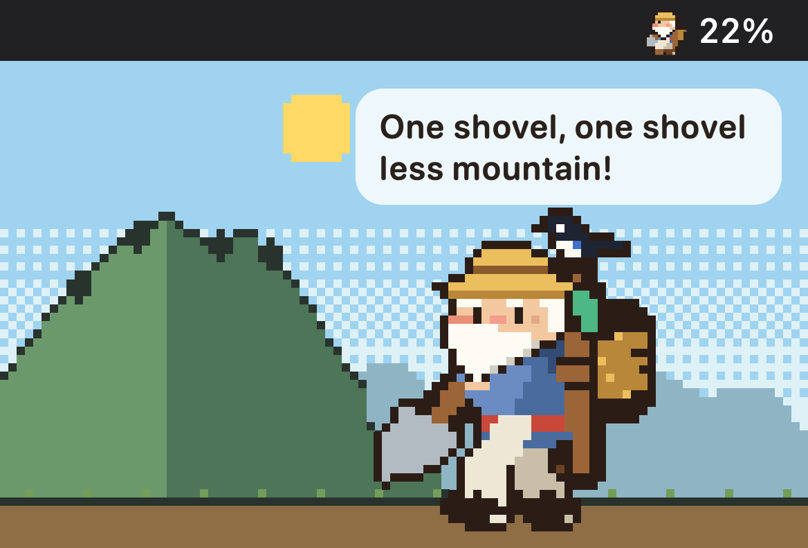

**Grandpa Yugong moves a mountain one token at a time.** A pixel-art menu-bar pet for your Claude Code and Codex usage limits: his carrier fills with your 5-hour limit, he naps when it runs out, and the mountain wears down with every token.

## Install
1. Download `TokenYugong-@VERSION@-macos-universal.zip` below (and its `.sha256` if you want to verify: `shasum -a 256 -c TokenYugong-@VERSION@-macos-universal.zip.sha256`). macOS 13 or later, Apple silicon or Intel.
2. Unzip and move `TokenYugong.app` to Applications.
3. First launch: the app is not notarized yet. macOS 15+: open it once, then System Settings → Privacy & Security → **Open Anyway**. macOS 13-14: Control-click → Open.

Then connect Claude Code with one status-line snippet (the app's guide copies it; [details](https://github.com/s3onghyun/token-yugong#connect-claude-code)). Codex needs no setup.

## Privacy
No account, no analytics, no telemetry. The app reads Claude Code, Codex and Gemini CLI files on your Mac. Its only network requests are a once-a-day check of this repository's latest release (can be turned off) and, only if you paste a key, the OpenAI costs or DeepSeek balance API. [Everything it reads](https://github.com/s3onghyun/token-yugong#privacy).

Made by one person with AI coding assistants. Code MIT; the character art is all rights reserved (personal-use grant). Feedback and translations welcome in Issues.

## What's new
