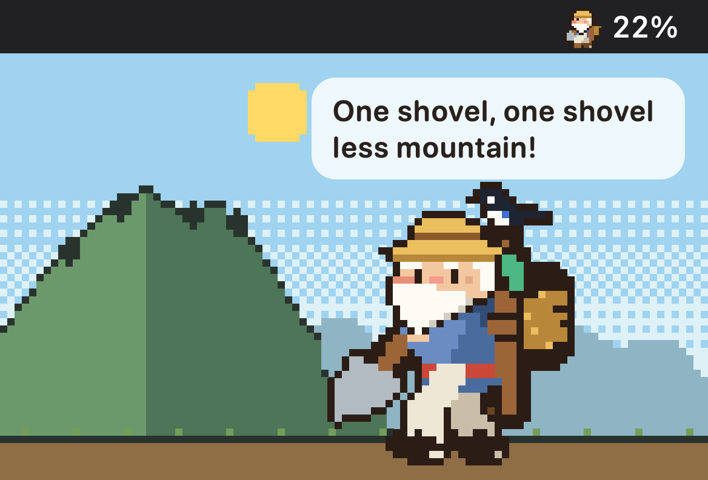
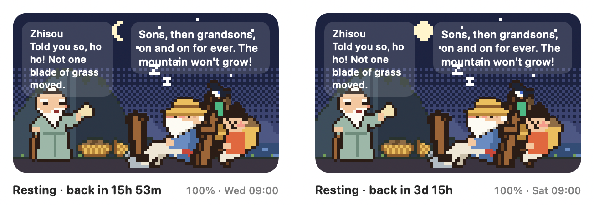
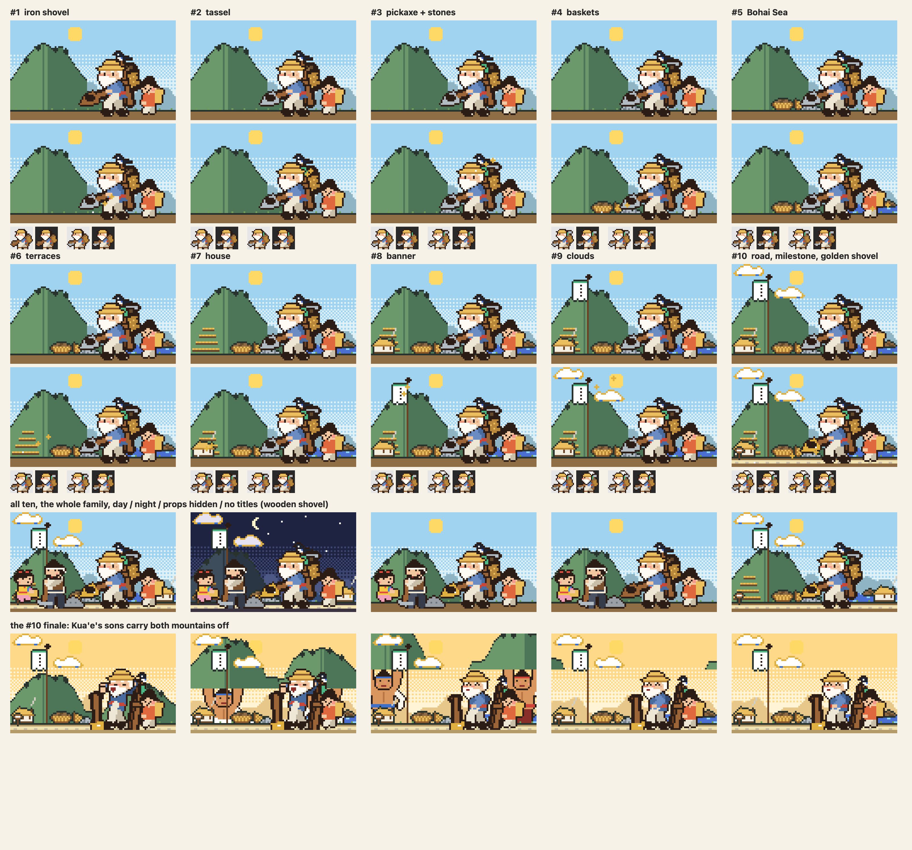
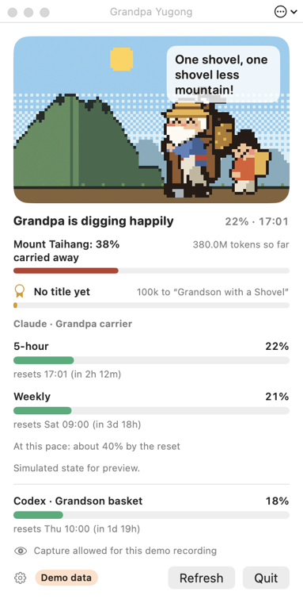

<h1 align="center">Token Yugong 愚公</h1>

<p align="center"><b>愚公じいさんが、トークンひとすくいずつ山を移します。</b><br>
Claude Code と Codex の使用リミットを見せる、ドット絵のメニューバーペットです。
5時間リミットの分だけ背負子が埋まり、使い切ると昼寝して、使ったトークンの分だけ山が削れていきます。</p>

<p align="center">
  <a href="README.md">English</a> · <a href="README.zh-CN.md">简体中文</a> · 日本語 · <a href="README.ko.md">한국어</a>
</p>

> この README は AI 補助で翻訳しました。修正を歓迎します（Issue か PR で）。

<p align="center">
  <a href="https://github.com/s3onghyun/token-yugong/releases/latest"></a>
  
  <a href="LICENSE"></a>
  
</p>

<p align="center"><br>
<sub>アプリ自身の描画コードでデモデータを描いたものです（<code>YugongSheet --hero</code>）。</sub></p>

**インストール**（macOS 13 以降、Apple silicon・Intel）：[Releases](https://github.com/s3onghyun/token-yugong/releases/latest) から
`TokenYugong-<version>-macos-universal.zip` をダウンロードして展開し、`TokenYugong.app` をアプリケーションフォルダへ移動します。
まだ公証を受けていないため、初回起動時に一度だけ許可が必要です。[初回起動](#初回起動) を参照してください。
そのあと [Claude Code と接続](#claude-code-との接続) します（スニペット1つ。Codex は設定不要）。

## 表示されるもの

『列子』湯問篇「愚公山を移す」で、九十歳にして山をひとすくいずつ移しはじめた愚公じいさんが、
Mac のメニューバーに住んで Claude Code の使用量を見せてくれます。

- **背負子は5時間リミットです。** 背負子に土が積み上がっていき、いっぱいになると座って昼寝します。
  メニューバーにはリセットまでのカウントダウンが出て、通知が一度届きます（リセット時にもう一度）。
  週間リミットを使い切ると、満月の下で長い休みに入ります。

  

- **週間リミットだけのアカウント**（Ultra で確認済み）：背負子は週間リミットになり、昼寝するのは
  使い切ったときだけです。今日の取り分（週の1/7、使わなかった日の分は持ち越し）がペースの目安で、
  それを超えると汗をかいて、ゆっくりやろうと頼んできます。5時間メーターを作り出すことはありません。
- **ペース**（RunCat 風）：この Mac でトークンが速く流れるほど速く掘り、静かなときはシャベルに
  もたれてカササギとおしゃべりし、リミットに近づくと息が上がります。
- **山** は、これまでに使ったすべてのトークンの分だけ削れていきます（記録はこの Mac に保存）。山をまるごと
  運び終えると天が心を打たれ、夸娥氏の二人の息子が山を運び去り、次の山へ移ります。
- **物語の続き。** プランを変えたときや新しい週には、おばあさんが「その土をどこに捨てるつもり？」と
  たずねに来ます（山が半分なくなると応援してくれます）。リミットを使い切ると智叟が笑いに来て、
  おじいさんは『列子』のとおりに言い返します。
- **家族。** おじいさんが受け持つ AI を選べます（既定は Claude）。息子、孫、隣の子もそれぞれ別の AI を
  受け持てます：Codex、Gemini CLI、または OpenAI や DeepSeek の API（リミットの代わりに月の予算）。
  既定では孫が Codex を受け持ちます。
- **データがなければ推測しない。** AI がリミットを報告するまで、受け持つ人は「わからない」と言います。
  Gemini CLI は Mac にリミットを残さず、DeepSeek は残高しか報告しないので、この二つは常にそう言います。
- **称号。** 運んだトークンで位が上がります。*シャベルを持った孫*（最初の1時間）から
  *山を移した愚公*（数か月）まであり、いくつかの実績（7日連続、リミット内で過ごした1週間、
  1日に2つの AI など）もあります。知らせはカササギがドット絵の紙吹雪と一緒に運んできます。
  称号ウィンドウにはすべての称号が並び、共有用の称号カード（PNG、個人情報なし）を保存できます。
- **称号の報酬。** 称号ごとに絵に1つずつ物が加わり、そのまま残ります。木のシャベルに鉄の刃がつき、
  続いて房飾り、つるはし、もっこ、渤海、段々畑、一家の家、一家の旗、瑞雲、そして最後に金のシャベル、
  開けた道、夸娥氏の息子たちが太行山と王屋山を運び去る一度きりのフィナーレ。うち5つはメニューバーにも
  出ます。設定 › *背景の小物を隠す* でおじいさんの道具だけを残せます。

  

メニューバーのスプライト、ポップオーバーの場面、アプリアイコンまで、すべてドット絵です。

## インストール

macOS 13 以降が必要です。

### アプリをダウンロード

1. 最新の [GitHub Release](https://github.com/s3onghyun/token-yugong/releases/latest) から
   `TokenYugong-<version>-macos-universal.zip` とその `.sha256` ファイルをダウンロードします。
2. ターミナルでダウンロードを検証します（`<version>` はリリースのバージョンに置き換えてください）：

   ```sh
   shasum -a 256 -c TokenYugong-<version>-macos-universal.zip.sha256
   ```

3. ZIP をダブルクリックし、`TokenYugong.app` を `/Applications` へ移動します。

Yugong Pet 0.2.0 から移行する場合は、それを終了して `YugongPet.app` を削除してください。設定、山、称号は
そのまま引き継がれます（同じ設定ドメイン）。*ログイン時に開く* をオンにしていた場合は、設定で一度オフにしてからオンに戻してください。

### 初回起動

アプリは ad-hoc 署名済みですが、まだ公証を受けていないため、macOS が一度だけ確認してきます：

1. アプリを開きます。macOS が検証できないと表示するので、**完了** をクリックします。
2. **システム設定 → プライバシーとセキュリティ** を開いて下へスクロールし、Token Yugong の横の
   **このまま開く** をクリックして、Touch ID かパスワードで確認します。
3. macOS 13〜14 では、代わりに Control キーを押しながらアプリをクリックして **開く** を選んでも構いません。

先にコードを確認したい場合は、自分でビルドしてください（下記）。

### ソースからビルド

ローカルでビルドするには、Swift ツールチェーン（Xcode または Command Line Tools）を入れてから：

```sh
git clone https://github.com/s3onghyun/token-yugong.git && cd token-yugong
./scripts/bundle.sh            # builds build/TokenYugong.app (ad-hoc signed, not notarized)
open build/TokenYugong.app     # or move it to /Applications first
```

初回起動時には短いガイドが出ます。最後のページに Claude Code ステータスライン用の **スニペットをコピー**
ボタンがあります（下記）。終了はポップオーバーから行います。

バンドルを作らずに実行することもできます：`swift run -c release TokenPet`（この場合、通知とログイン時の起動は使えません）。

## Claude Code との接続

Claude Code は、ステータスラインのコマンドに公式のリミット（`rate_limits.five_hour` と
`rate_limits.seven_day`：使用率 %、リセット時刻）を渡します。ブリッジスクリプトはそのオブジェクトだけを
`~/.claude/token-pet/limits.json` に保存します。プロンプト、パス、セッション ID は保存せず、ネットワークも使いません。
ステータスラインは成功した応答しか報告しないため、リミットを使い切ると 99% で止まります。そこでアプリは、
Claude Code が自分のセッションログに書く拒否（`usage_limit_reached`、ウィンドウとリセット時刻つき）も読み取り、
100% を表示しておじいさんを休ませます。

ガイド（または設定 › *使い方と Claude Code の接続…*）の **スニペットをコピー** は、ブリッジを
`~/.claude/token-pet/` にコピーし、次の内容をクリップボードに入れます。これを `~/.claude/settings.json` の
一番外側のオブジェクトに自分で貼り付けてください。アプリがこのファイルを書き換えることはありません：

```json
"statusLine": {
  "type": "command",
  "command": "sh ~/.claude/token-pet/statusline-bridge.sh"
}
```

すでにステータスラインを使っている場合は、それを残したまま 1 行目を
`input=$(cat); printf '%s' "$input" | sh ~/.claude/token-pet/statusline-bridge.sh >/dev/null` にし、
JSON は `$input` から読んでください。

ブリッジは `jq` があればそれを使い（macOS 15 以降は標準搭載）、なければ `plutil` を使います。
Codex は設定不要です。Codex 自身のログ（`~/.codex/sessions`）にリミットが記録されています。Gemini CLI も
設定不要です（トークンは `~/.gemini/tmp` から読みます）。

**API の予算。** OpenAI API の場合は、設定 › 家族 で家族の誰かに OpenAI を受け持たせ、月の予算を USD で入力し、
**Admin key** を貼り付けます（OpenAI はコストを Admin key にしか報告しません）。メーターは今月の支出 ÷ 予算で、
15 分ごとに問い合わせます。DeepSeek の場合は API キーを貼り付けると残高が見えます。DeepSeek は支出を報告しないため、
メーターは「わからない」と表示します。キーはログインキーチェーンにだけ保存されます。この二つと、1日1回の
アップデート確認（下記）だけが、アプリがネットワークを使う場面です。

## 愚公ウィンドウ

メニューバーのおじいさんをクリックするとポップオーバーが開き、場面、山、称号、すべてのメーターが見られます。
初回起動時には一度だけおじいさんを指し示します（「おじいさんをクリックしてみてください」）。ポップオーバーの
**ウィンドウ** ボタンを押すと、同じ場面がデスクトップに置いておける専用のウィンドウで開きます：



好きな場所へドラッグでき（縦置きを含む別のディスプレイにも）、角をドラッグしてサイズを変えられます。中身は
縦横比を保ったまま拡大縮小されます。タイトルバーの ⋯ ボタン（または右クリック）で、小・中・大、
通常のウィンドウ、*常に手前に表示*、*デスクトップに置く*（すべてのアプリのウィンドウの下、すべての操作スペースに表示）、
不透明度を選べます。Esc か閉じるボタンで隠れます。サイズ、位置、レベル、不透明度は記憶され、そのディスプレイが
なくなった場合はメイン画面に戻ってきます。設定 › *アプリ起動時に愚公ウィンドウも開く*（既定はオフ）で起動時に開き、
*ログイン時に開く* と組み合わせればログイン時に開きます。ウィンドウが閉じているか隠れている間は描画を止めます（CPU を使いません）。

## メニューバーがいっぱいのとき

macOS は、入りきらないメニューバーアイコンを黙って隠したり、カメラのノッチの裏に置いたりします。
おじいさんはそれに気づくと通知で一度知らせ、小さなフローティングウィンドウに引っ越します
（メニューバーの2倍の大きさのおじいさんと数字。クリックでそのディスプレイにポップオーバー、ドラッグで好きな場所へ、
右クリックで愚公ウィンドウを開くか隠す）。設定 › ミニウィンドウ：*メニューバーがいっぱいのとき*
（既定）、*常に*、*表示しない*。アプリをもう一度開くと必ずおじいさんが現れます：ポップオーバー、または
メニューバーに空きがなくミニウィンドウがオフのときは愚公ウィンドウです。

## 設定

ポップオーバーの歯車ボタンから開きます：言語（システム、English、한국어、日本語、简体中文。再起動なしですぐ切り替わります）、
メニューバーの数字（使用率、リセットまで、リセット時刻、なし）とその横におじいさんを出すかどうか、
家族（各メンバーが受け持つ AI、OpenAI の予算、API キー）、ミニウィンドウ、ログイン時に開く（既定はオフ、オプトインのみ）、
起動時の愚公ウィンドウ、アップデートの確認、ガイド。すべて UserDefaults ドメイン `TokenPet` に保存されます。
`defaults delete TokenPet` で山も含めてリセットできます。

日本語と中国語のテキストは AI 補助による翻訳です。修正を歓迎します（各文字列は `L.t(en, ko, ja, zh)` の
呼び出し1つで、`./test.sh` は翻訳の欠落や文字体系の誤りがあると失敗します）。

## アップデート

1日1回、アプリが GitHub に最新リリースを問い合わせます。`api.github.com/repos/s3onghyun/token-yugong/releases/latest`
への HTTPS GET 1回で、送るのは `User-Agent: TokenYugong/<version>`、`Accept`、固定の `Accept-Language: en` だけ。
Cookie もキャッシュも使いません。あなたや使用状況についての情報は何も送らず、テレメトリもありません。新しいバージョンが
出ると、ポップオーバーに **リリースページ** と **このバージョンをスキップ** の行が表示され、そのバージョンについて
通知が一度届きます。アプリが自分で何かをダウンロードしたりインストールしたりすることはありません。新しい ZIP を
ダウンロードし、`.sha256` を確認して、[インストール](#インストール) と同じ手順でアプリを置き換えてください。
設定 › *アップデートを確認（1日1回）* でオフにでき、*今すぐ確認* ですぐに問い合わせます。

## プライバシー

Token Yugong は Mac 上のファイルを読み、すべてをその Mac の中に留めます。アカウントも、分析も、テレメトリもありません。

| 読むもの | 理由 |
|---|---|
| `~/.claude/token-pet/limits.json` | ステータスラインのブリッジが書き込む Claude Code の公式リミット（使用率 %、リセット時刻。プロンプト、パス、セッション ID は含まない） |
| Claude Code のセッションログ（`~/.claude/projects`） | おじいさんのペースと山のためのトークン数、そしてリミットいっぱいを 100% と表示するための `usage_limit_reached` 拒否 |
| `~/.codex/sessions` | Codex 自身のリミットとトークン数 |
| `~/.gemini/tmp` | Gemini CLI のトークン数 |

- **ネットワーク：** 1日1回のアップデート確認（GitHub releases API への GET 1回、オフにできます）と、
  キーを貼り付けた場合に限り、15 分ごとの OpenAI の costs API または DeepSeek の残高 API だけです。
- **キー** はログインキーチェーンにだけ保存され、ほかには置きません。
- **設定と履歴**（山、称号）は、この Mac の UserDefaults ドメイン `TokenPet` に残ります。
  `defaults delete TokenPet` で消去できます。
- アプリは `~/.claude/settings.json` を書き換えません。ステータスラインのスニペットは自分で貼り付けてください。

## 数字がペットになるまで

すべてのルールは 1 ページ [LOGIC.md](LOGIC.md) にまとめてあり、どのルールにも単体テストがあります（`./test.sh`）。
要するに：公式のリミットだけを使い、ウィンドウがいつやり直しになるかはリセット時刻で決まり、週間リミットだけの
取り分は保存した状態を必要としないので、再起動しても複数の Mac でも同じ答えになります。

## 開発者向け

`swift run -c release TokenPet` にフラグを付けて実行します：`--demo lively|steady|straining|resting|morning|cutscene|cycle`、
`--lifetime <tokens>`、`--award rank:<0-9>|feat:<name>`、`--titles`（称号ウィンドウを開く）、`--window`（愚公ウィンドウを開く）、
`--tempo idle|low|high|veryHigh`、`--visitor wifeDoubting|wifeCheering|zhisou`、`--weekly-only`、`--lang en|ko|ja|zh|pseudo`
（`pseudo`：すべての文字列を約 40% 長くしてアクセント記号を付け、`--render` で文字の切れを見つける）、
`--stage`（録画用に、メニューバー項目とポップオーバーを1つのウィンドウに）、`--allow-capture`、`--open`、
`--settings`、`--guide`、`--pretend-hidden`（ミニウィンドウへの切り替えを試す）、
`--render <dir>`（PNG 静止画）、`--icon-set <dir>`、`--scan-report`（読み取った内容を表示）、
`--anim-stats`。`TOKENPET_PREFS=<domain>` を指定すると、テスト実行が自分の設定に影響しません。

キャラクターシート：`swift run -c release YugongSheet <dir> [--scenes] [--family] [--visitors] [--rewards]`。
`--social` は `docs/social-preview.png` を描き、`--hero` は `docs/hero.gif` のフレームを描きます。そのあと：
`ffmpeg -framerate 10 -i <dir>/hero-%03d.png -vf "split[a][b];[a]palettegen=max_colors=128:stats_mode=full[p];[b][p]paletteuse=dither=none" -loop 0 docs/hero.gif`。

コントリビュートについては [CONTRIBUTING.md](CONTRIBUTING.md) を参照してください。

## ライセンス

- アプリのコード（`Package.swift`、`Sources/`、`bridge/`、`scripts/`、`Tests/`）：MIT。[LICENSE](LICENSE) を参照してください。
- 愚公じいさんと `assets/` 以下のすべて（およびそこから作られた画像。`docs/` の画像など）は MIT ライセンスの
  対象 **ではありません**。All rights reserved で、個人利用の許諾があります。
  [assets/LICENSE.md](assets/LICENSE.md) と [assets/PROVENANCE.md](assets/PROVENANCE.md) を参照してください。

[変更履歴](CHANGELOG.md)
