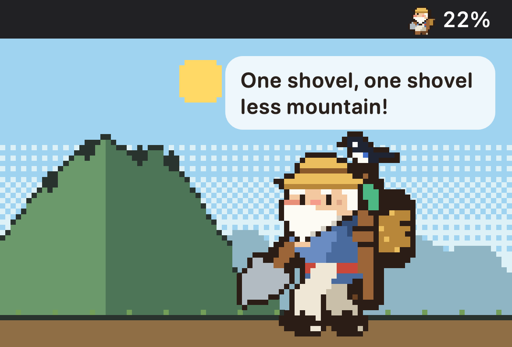
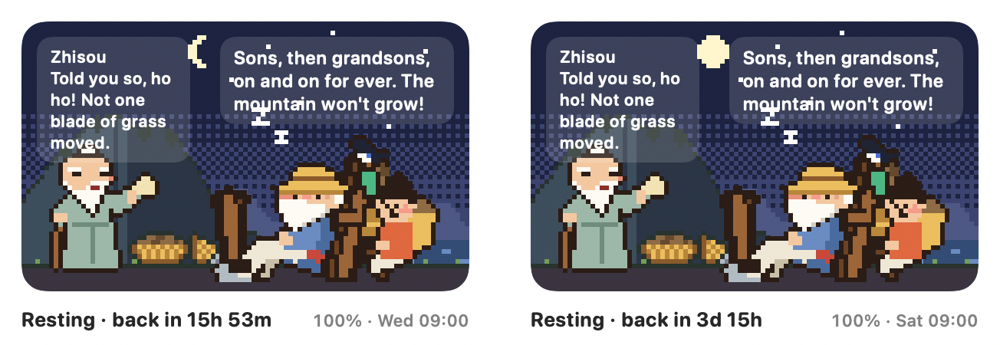
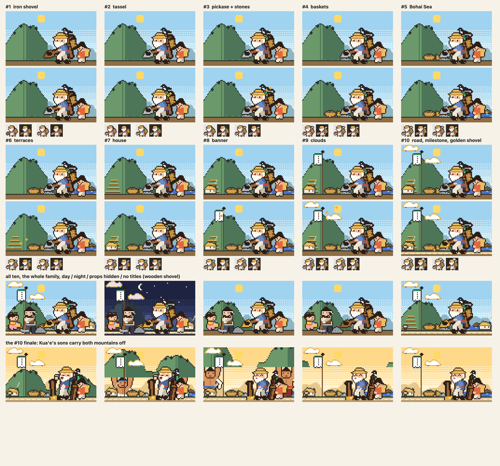
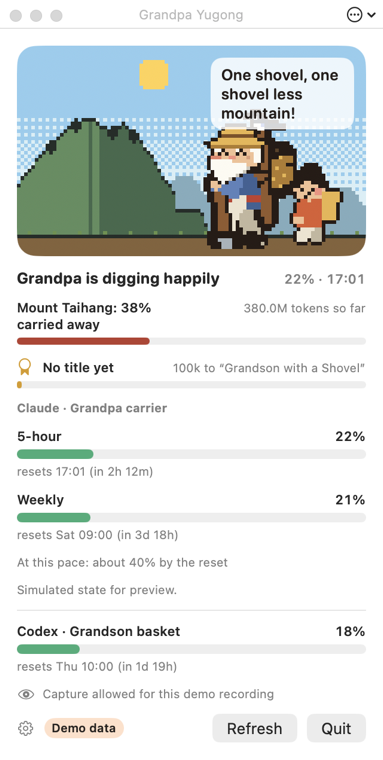

<h1 align="center">Token Yugong 愚公</h1>

<p align="center"><b>Claude Code と Codex の使用リミットを、macOS のメニューバーでひと目で確認できます。</b><br>
ドット絵のメニューバーペットで、愚公じいさんがトークンひとすくいずつ山を移します。
5時間リミットの分だけ背負子が埋まり、使い切ると昼寝して、使ったトークンの分だけ山が削れていきます。</p>

<p align="center">
  <a href="README.md">English</a> · <a href="README.zh-CN.md">简体中文</a> · 日本語 · <a href="README.ko.md">한국어</a>
</p>

> この README は AI 補助で翻訳しました。修正を歓迎します（Issue か PR で）。

<p align="center">
  <a href="https://github.com/s3onghyun/token-yugong/releases/latest"></a>
  
  <a href="LICENSE"></a>
  
</p>

<p align="center"><br>
<sub>アプリ自身の描画コードでデモデータを描いたものです（<code>YugongSheet --hero</code>）。</sub></p>

**インストール**（macOS 13 以降、Apple silicon・Intel）：[Releases](https://github.com/s3onghyun/token-yugong/releases/latest) から
`TokenYugong-<version>-macos-universal.zip` をダウンロードして展開し、`TokenYugong.app` をアプリケーションフォルダへ移動します。
Homebrew でも入れられます：`brew install --cask s3onghyun/tap/token-yugong`。
Developer ID で署名され Apple の公証を受けているので、ほかのアプリと同じように開けます（[初回起動](#初回起動)）。
そのあと [Claude Code と接続](#claude-code-との接続) します（スニペット1つ。Codex は設定不要）。

## 表示されるもの

『列子』湯問篇「愚公山を移す」で、九十歳にして山をひとすくいずつ移しはじめた愚公じいさんが、
Mac のメニューバーに住んで Claude Code の使用量を見せてくれます。

- **背負子は5時間リミットです。** 背負子に土が積み上がっていき、いっぱいになると座って昼寝します。
  メニューバーにはリセットまでのカウントダウンが出て、通知が一度届きます（リセット時にもう一度）。
  週間リミットを使い切ると、満月の下で長い休みに入ります。

  

- **週間リミットだけのアカウント**（Ultra で確認済み）：背負子は週間リミットになり、昼寝するのは
  使い切ったときだけです。今日の取り分（週の1/7、使わなかった日の分は持ち越し）がペースの目安で、
  それを超えると汗をかいて、ゆっくりやろうと頼んできます。5時間メーターを作り出すことはありません。
- **ペース**（RunCat 風）：この Mac でトークンが速く流れるほど速く掘り、静かなときはシャベルに
  もたれてカササギとおしゃべりし、リミットに近づくと息が上がります。
- **山** は、これまでに使ったすべてのトークンの分だけ削れていきます（記録はこの Mac に保存）。山をまるごと
  運び終えると天が心を打たれ、夸娥氏の二人の息子が山を運び去り、次の山へ移ります。
- **物語の続き。** プランを変えたときや新しい週には、おばあさんが「その土をどこに捨てるつもり？」と
  たずねに来ます（山が半分なくなると応援してくれます）。リミットを使い切ると智叟が笑いに来て、
  おじいさんは『列子』のとおりに言い返します。
- **家族。** おじいさんが受け持つ AI を選べます（既定は Claude）。息子、孫、隣の子もそれぞれ別の AI を
  受け持てます：Codex、Gemini CLI、または OpenAI や DeepSeek の API（リミットの代わりに月の予算）。
  既定では孫が Codex を受け持ちます。
- **データがなければ推測しない。** AI がリミットを報告するまで、受け持つ人は「わからない」と言います。
  Gemini CLI は Mac にリミットを残さず、DeepSeek は残高しか報告しないので、この二つは常にそう言います。
- **称号。** 運んだトークンで位が上がります。*シャベルを持った孫*（最初の1時間）から
  *山を移した愚公*（数か月）まであり、いくつかの実績（7日連続、リミット内で過ごした1週間、
  1日に2つの AI など）もあります。知らせはカササギがドット絵の紙吹雪と一緒に運んできます。
  称号ウィンドウにはすべての称号が並び、共有用の称号カード（PNG、個人情報なし）を保存できます。
- **称号の報酬。** 称号ごとに絵に1つずつ物が加わり、そのまま残ります。木のシャベルに鉄の刃がつき、
  続いて房飾り、つるはし、もっこ、渤海、段々畑、一家の家、一家の旗、瑞雲、そして最後に金のシャベル、
  開けた道、夸娥氏の息子たちが太行山と王屋山を運び去る一度きりのフィナーレ。うち5つはメニューバーにも
  出ます。設定 › *背景の小物を隠す* でおじいさんの道具だけを残せます。

  

メニューバーのスプライト、ポップオーバーの場面、アプリアイコンまで、すべてドット絵です。

## インストール

macOS 13 以降が必要です。

### Homebrew

```sh
brew install --cask s3onghyun/tap/token-yugong
```

`brew upgrade --cask token-yugong` で更新します。

Homebrew 7 以降は、ほかの tap の cask を信頼（trust）するまで読み込みません。上のようにフルネームで
インストールすると、この cask だけが自動で信頼されます。インストール前に `brew info --cask s3onghyun/tap/token-yugong`
で確かめたいときは、先に `brew trust --cask s3onghyun/tap/token-yugong` を実行してください。

### アプリをダウンロード

1. 最新の [GitHub Release](https://github.com/s3onghyun/token-yugong/releases/latest) から
   `TokenYugong-<version>-macos-universal.zip` とその `.sha256` ファイルをダウンロードします。
2. ターミナルでダウンロードを検証します（`<version>` はリリースのバージョンに置き換えてください）：

   ```sh
   shasum -a 256 -c TokenYugong-<version>-macos-universal.zip.sha256
   ```

3. ZIP をダブルクリックし、`TokenYugong.app` を `/Applications` へ移動します。

Yugong Pet 0.2.0 から移行する場合は、それを終了して `YugongPet.app` を削除してください。設定、山、称号は
そのまま引き継がれます（同じ設定ドメイン）。*ログイン時に開く* をオンにしていた場合は、設定で一度オフにしてからオンに戻してください。

### 初回起動

0.3.3 以降のリリースは Developer ID で署名され、Apple の公証を受けてチケットがステープルされているので、
ダブルクリックでそのまま開きます。インターネットからダウンロードしたアプリを開くか macOS が一度確認することはあります：**開く** をクリックしてください。

<details>
<summary>0.3.2 以前（公証なし）</summary>

これらのビルドは ad-hoc 署名のみのため、macOS が一度だけ確認してきます：

1. アプリを開きます。macOS が検証できないと表示するので、**完了** をクリックします。
2. **システム設定 → プライバシーとセキュリティ** を開いて下へスクロールし、Token Yugong の横の
   **このまま開く** をクリックして、Touch ID かパスワードで確認します。
3. macOS 13〜14 では、代わりに Control キーを押しながらアプリをクリックして **開く** を選んでも構いません。

</details>

先にコードを確認したい場合は、自分でビルドしてください（下記）。

### ソースからビルド

ローカルでビルドするには、Swift ツールチェーン（Xcode または Command Line Tools）を入れてから：

```sh
git clone https://github.com/s3onghyun/token-yugong.git && cd token-yugong
./scripts/bundle.sh            # builds build/TokenYugong.app (ad-hoc signed; releases are notarized)
open build/TokenYugong.app     # or move it to /Applications first
```

初回起動時には短いガイドが出ます（3ページ、約30秒、いつでも **スキップ** できます）。おじいさんが何を見せるか、
Claude Code ステータスラインをつなぐ **接続**（下記）、設定の場所を案内します。設定 › *使い方と Claude Code の接続…*
でもう一度開けます。終了はポップオーバーから行います。

バンドルを作らずに実行することもできます：`swift run -c release TokenPet`（この場合、通知とログイン時の起動は使えません）。

## Claude のリミット：愚公が Claude Code に尋ねます

愚公は、手を加えていない Claude Code にリミットを尋ねます。自分で入力できるのと同じ `/usage` です：

```sh
claude -p /usage --no-session-persistence --setting-sources project --strict-mcp-config --output-format stream-json --verbose
```

読むのは Claude Code が出力する構造化された行（`usage_report.rate_limits.limits[]`：5時間の `session` 行と
`weekly_all` 行、それぞれ使用率 % とリセット時刻）だけで、人が読む文章は解釈しません。このコマンドは AI への
リクエストをせず、費用もかかりません（`total_cost_usd: 0`）。セッションを残さず、ユーザー設定・hook・MCP サーバーを
読み込まず、愚公専用の空のフォルダ（`~/Library/Application Support/TokenPet/claude-usage`）で実行します。1回あたり
CPU 約2秒です。愚公は Claude のログイントークンを読まず、Anthropic のエンドポイントを自分で呼ぶこともありません。
Anthropic の規約は、手を加えていない Claude Code に自分のサブスクリプションでログインすることを認めていますが、
ほかのツールが Claude の認証情報を集めたり中継したりすることは認めていません。

**ステータスラインを使わない理由。** Claude Code のステータスラインはセッションの最後の応答のリミットを受け取り
ますが、アカウント名も時刻もありません。アカウントが2つあると（古いセッションが動いたままの `/login`、Max プラン
2つなど）、メニューバーの1行に2つのアカウントの数字が交互に出ていました（0.2.x〜0.3.8）。アカウントを推測する方法は
どれもどこかで破綻し、0.3.8 の週間リセット時刻も2つのアカウントで同じになりうるため同様でした。1つのプロファイル
の答えはそのプロファイルのログインのものなので、推測するものが残りません。

**頻度。** わざと控えめに尋ねます。アカウントはあなたのもので、つつき続けるツールは不正利用に見えかねません。

| いつ | 愚公が尋ねるもの |
|---|---|
| アプリ起動時 | プロファイルごとに1回 |
| ポップオーバーを開いたとき | 直近5分に尋ねていないプロファイル |
| バックグラウンド | 30分ごと（±5分、ランダムなので時刻がそろわない）。設定 › *30分ごとに Claude Code に尋ねる* でオフ |
| 入力中、セッションの応答時、Claude Code が忙しいとき | 尋ねない |
| Claude Code が新しい行なしで答えた（429/403 のレート制限、ログアウト、API キー）か、このバージョンが読めない出力のとき | そのプロファイルは1時間、次は2・4時間…最長1日休みます。ポップオーバーを再び開くまでバックグラウンド更新も飛ばします |

尋ねる合間は、ポップオーバーが最後の答えをその古さとともに表示します（「12分前 に確認」）。数字は最大30分ほど前の
ものになりえ、ポップオーバーを開くと再び尋ねます。読めない出力は「不明」であり、古い数字は出しません。

**複数のアカウント。** 1つのプロファイルには1つのログインがあります。既定のプロファイルは `~/.claude` です。別の
アカウントを専用の `CLAUDE_CONFIG_DIR` フォルダ（例：`~/.claude-work`）で使っているなら、設定 › アカウント ›
*Claude Code のプロファイルフォルダを追加* でそのフォルダを加えてください。プロファイルごとに行があり、ニックネームが
なければログイン中のメールアドレス（そのプロファイルの `.claude.json`）で名前がつきます。おじいさんが見る行を選んで
ください。プロファイル内で `/login` すると、次の答えから新しいアカウントのものになり、新しい名前で表示されます。
1つのプロファイルを共有するアカウントは、一度に1つ（ログイン中のもの）しか見えません。

## Claude Code のステータスライン（任意）

アプリには不要です。**接続** すると Claude Code のステータスラインにおじいさんの足あと（`🐾 5h 42%`、そのセッション
自身の数字）が出ます。ブリッジスクリプトは Claude Code が渡す JSON からその数字を表示するだけで、何も保存しません。

**ワンクリック：** ガイド（または設定 › *使い方と Claude Code の接続…*）で **接続** を押します。変更前と変更後の
`statusLine` を見せ、了承したときだけ書き込みます。**コマンド 1 行**（エージェントもこれを使います）：

```sh
/Applications/TokenYugong.app/Contents/MacOS/TokenPet setup            # --dry-run を付けると見るだけ
/Applications/TokenYugong.app/Contents/MacOS/TokenPet setup --undo     # 元に戻す
```

どちらもブリッジを `~/.claude/token-pet/` にコピーし、`~/.claude/settings.json` の `statusLine` キーだけを
変えます。ほかのバイトはそのまま、バックアップは `~/.claude/token-pet/settings.json.<時刻>.bak`（自分だけが読め、新しい 3 つだけ残します）、もう一度
実行しても何も変わらず、シンボリックリンクはリンクのまま残ります。すでにあるステータスラインは残します：
`sh ~/.claude/token-pet/statusline-bridge.sh --chain '<元のコマンド>'` になり、同じ入力を受け取って、表示は
元の出力のままです。`--undo` で元のコマンドに戻ります。この Mac に Claude Code がない（`~/.claude` がない）
ときは、そう伝えて何も書きません。

手で設定したい場合は **スニペットをコピー** で、ブリッジと次の内容をクリップボードに入れ、
`~/.claude/settings.json` の一番外側のオブジェクトに貼り付けてください：

```json
"statusLine": {
  "type": "command",
  "command": "sh ~/.claude/token-pet/statusline-bridge.sh"
}
```

（手で設定し、ステータスラインがすでにある場合：`"command": "sh ~/.claude/token-pet/statusline-bridge.sh --chain '<元のコマンド>'"`）

**コマンドライン。** `TokenPet status [--json]` はステータスラインの接続と、おじいさんが見るプロファイルについてアプリが保存した最後の `/usage` の答えを表示し（自分では Claude Code に尋ねません）、
`TokenPet setup [--undo] [--dry-run] [--json]` は上の接続です。`--json` ではキーが固定された JSON オブジェクトを
1 つ出力します（`result`、`before`、`after`、`backup`、`claude.connection`、`claude.reading.five_hour.used_percentage` など）。
エラーは stderr にわかりやすい言葉で出し、終了コード 1、
`{"error": "no_claude" | "unreadable_settings" | "unknown_status_line" | "no_bridge" | "write_failed"}` を返します。

ブリッジは `jq` があればそれを使い（macOS 15 以降は標準搭載）、なければ `plutil` を使います。
Codex は設定不要です。Codex 自身のログ（`~/.codex/sessions`）にリミットが記録されています。Gemini CLI も
設定不要です（トークンは `~/.gemini/tmp` から読みます）。

**API の予算。** OpenAI API の場合は、設定 › 家族 で家族の誰かに OpenAI を受け持たせ、月の予算を USD で入力し、
**Admin key** を貼り付けます（OpenAI はコストを Admin key にしか報告しません）。メーターは今月の支出 ÷ 予算で、
15 分ごとに問い合わせます。DeepSeek の場合は API キーを貼り付けると残高が見えます。DeepSeek は支出を報告しないため、
メーターは「わからない」と表示します。キーはログインキーチェーンにだけ保存されます。この二つと、アップデートの
確認とダウンロード（下記）だけが、アプリがネットワークを使う場面です。

## 愚公ウィンドウ

メニューバーのおじいさんをクリックするとポップオーバーが開き、場面、山、すべてのメーターが見られます。「更新」の横の ⌄
ボタン（もっと見る）で称号、数字の出どころ、Claude アカウント、掘る速さ、画面共有の設定が開き、開いた状態は記憶されます。
初回起動時には一度だけおじいさんを指し示します（「おじいさんをクリックしてみてください」）。ポップオーバーの
**ウィンドウ** ボタンを押すと、同じ場面がデスクトップに置いておける専用のウィンドウで開きます：



好きな場所へドラッグでき（縦置きを含む別のディスプレイにも）、角をドラッグしてサイズを変えられます。中身は
縦横比を保ったまま拡大縮小されます。タイトルバーの ⋯ ボタン（または右クリック）で、小・中・大、*コンパクト*（場面と状態の1行だけ）、
通常のウィンドウ、*常に手前に表示*、*デスクトップに置く*（すべてのアプリのウィンドウの下、すべての操作スペースに表示）、
不透明度を選べます。Esc か閉じるボタンで隠れます。サイズ、位置、レベル、不透明度は記憶され、そのディスプレイが
なくなった場合はメイン画面に戻ってきます。設定 › *アプリ起動時に愚公ウィンドウも開く*（既定はオフ）で起動時に開き、
*ログイン時に開く* と組み合わせればログイン時に開きます。ウィンドウが閉じているか隠れている間は描画を止めます（CPU を使いません）。

## メニューバーがいっぱいのとき

macOS は、入りきらないメニューバーアイコンを黙って隠したり、カメラのノッチの裏に置いたりします。
おじいさんはそれに気づくと通知で一度知らせ、小さなフローティングウィンドウに引っ越します
（メニューバーの2倍の大きさのおじいさんと数字。クリックでそのディスプレイにポップオーバー、ドラッグで好きな場所へ、
右クリックで愚公ウィンドウを開くか隠す）。設定 › ミニウィンドウ：*メニューバーがいっぱいのとき*
（既定）、*常に*、*表示しない*。アプリをもう一度開くと必ずおじいさんが現れます：ポップオーバー、または
メニューバーに空きがなくミニウィンドウがオフのときは愚公ウィンドウです。

## 設定

ポップオーバーの歯車ボタンから開きます：言語（システム、English、한국어、日本語、简体中文。再起動なしですぐ切り替わります）、
メニューバーの数字（使用率、リセットまで、リセット時刻、なし）とその横におじいさんを出すかどうか、
家族（各メンバーが受け持つ AI、OpenAI の予算、API キー）、ミニウィンドウ、ログイン時に開く（既定はオフ、オプトインのみ）、
起動時の愚公ウィンドウ、アップデートの確認、ガイド。すべて UserDefaults ドメイン `TokenPet` に保存されます。
`defaults delete TokenPet` で山も含めてリセットできます。

日本語と中国語のテキストは AI 補助による翻訳です。修正を歓迎します（各文字列は `L.t(en, ko, ja, zh)` の
呼び出し1つで、`./test.sh` は翻訳の欠落や文字体系の誤りがあると失敗します）。

## アップデート

1日1回、アプリが GitHub に最新リリースを問い合わせます。`api.github.com/repos/s3onghyun/token-yugong/releases/latest`
への HTTPS GET 1回で、送るのは `User-Agent: TokenYugong/<version>`、`Accept`、固定の `Accept-Language: en` だけ。
Cookie もキャッシュも使いません。あなたや使用状況についての情報は何も送らず、テレメトリもありません。新しいバージョンが
出ると、ポップオーバーに **アップデート**、**リリースページ**、**このバージョンをスキップ** の行が表示され、そのバージョン
について通知が一度届きます。**アップデート** を押すまでは何もダウンロードしません。押すと
`github.com/s3onghyun/token-yugong/releases/download/v<version>/` からそのリリースの ZIP を取得して一時フォルダに展開し、
同じバンドル ID の Token Yugong であること、ちょうどそのバージョンであること、今のアプリと同じ Developer ID チームの有効な署名であること（`codesign --verify`）、
公証済みであること（`spctl --assess`）を確かめてから（自分でビルドした ad-hoc 署名のアプリは署名だけを確かめます）、今動いている場所のアプリと入れ替えて再起動します。途中で失敗しても今のアプリはそのまま残ります。
Homebrew でインストールした場合は、代わりに `brew upgrade --cask s3onghyun/tap/token-yugong` とコピーボタンを表示します
（Homebrew の記録がずれないように）。アプリを置き換えられない場所（書き込みできないフォルダ）では、リリースページから
ダウンロードし、[インストール](#インストール) と同じ手順で置き換えてください。
設定 › *アップデートを確認（1日1回）* でオフにでき、*今すぐ確認* ですぐに問い合わせます。

## プライバシー

Token Yugong は Mac 上のファイルを読み、すべてをその Mac の中に留めます。アカウントも、分析も、テレメトリもありません。

| 読むもの | 理由 |
|---|---|
| プロファイルごとに実行する `claude -p /usage`（上記） | Claude の公式リミット：5時間と週間の使用率 %、リセット時刻 |
| 各プロファイルの `.claude.json`（`oauthAccount.emailAddress` のみ） | そのプロファイルの行の名前 |
| Claude Code のセッションログ（`~/.claude/projects`） | おじいさんのペースと山のためのトークン数 |
| `~/.codex/sessions` | Codex 自身のリミットとトークン数 |
| `~/.gemini/tmp` | Gemini CLI のトークン数 |

- **ネットワーク：** 愚公自身は Anthropic に接続しません。`/usage` のために実行する `claude` が、いつもの Claude Code
  と同じように接続します（最近の値を持っていれば尋ねずにそれで答えることもあります）。そのほかは 1日1回のアップデート確認（GitHub releases API への GET 1回、オフにできます）、**アップデート** を押したときのリリース ZIP、
  キーを貼り付けた場合に限り、15 分ごとの OpenAI の costs API または DeepSeek の残高 API だけです。
- **キー** はログインキーチェーンにだけ保存され、ほかには置きません。
- **設定と履歴**（山、称号）は、この Mac の UserDefaults ドメイン `TokenPet` に残ります。
  `defaults delete TokenPet` で消去できます。`/usage` の答えごと（プロファイル、%、リセット時刻。メールアドレスなし）に
  `~/Library/Application Support/TokenPet/claude-readings.log`（512 KB のファイル最大 2 つ）に記録され、
  おかしな数字を後から追えます。いつ削除しても構いません。
- アプリが `~/.claude/settings.json` を書き換えるのは、**接続** を押したとき（変更内容を見せたあと）か
  `TokenPet setup` を実行したときだけで、そのときも `statusLine` だけをバックアップ付きで変えます。`TokenPet setup --undo` で戻せます。

## 数字がペットになるまで

すべてのルールは 1 ページ [LOGIC.md](LOGIC.md) にまとめてあり、どのルールにも単体テストがあります（`./test.sh`）。
要するに：公式のリミットだけを使い、ウィンドウがいつやり直しになるかはリセット時刻で決まり、週間リミットだけの
取り分は保存した状態を必要としないので、再起動しても複数の Mac でも同じ答えになります。

## 開発者向け

`swift run -c release TokenPet` にフラグを付けて実行します：`--demo lively|steady|straining|resting|morning|cutscene|cycle`、
`--lifetime <tokens>`、`--award rank:<0-9>|feat:<name>`、`--titles`（称号ウィンドウを開く）、`--window`（愚公ウィンドウを開く）、
`--tempo idle|low|high|veryHigh`、`--visitor wifeDoubting|wifeCheering|zhisou`、`--weekly-only`、`--lang en|ko|ja|zh|pseudo`
（`pseudo`：すべての文字列を約 40% 長くしてアクセント記号を付け、`--render` で文字の切れを見つける）、
`--stage`（録画用に、メニューバー項目とポップオーバーを1つのウィンドウに）、`--allow-capture`、`--open`、
`--settings`、`--guide`、`--pretend-hidden`（ミニウィンドウへの切り替えを試す）、
`--render <dir>`（PNG 静止画）、`--icon-set <dir>`、`--scan-report`（読み取った内容を表示）、`status`・`setup`（上のコマンドライン）、
`--anim-stats`。`HOME=<dir>` を付けると使い捨てのホームで全部を動かせます。`TOKENPET_PREFS=<domain>` を指定すると、テスト実行が自分の設定に影響しません。

キャラクターシート：`swift run -c release YugongSheet <dir> [--scenes] [--family] [--visitors] [--rewards]`。
`--social` は `docs/social-preview.png` を描き、`--hero` は `docs/hero.gif` のフレームを描きます。そのあと：
`ffmpeg -framerate 10 -i <dir>/hero-%03d.png -vf "split[a][b];[a]palettegen=max_colors=128:stats_mode=full[p];[b][p]paletteuse=dither=none" -loop 0 docs/hero.gif`。

コントリビュートについては [CONTRIBUTING.md](CONTRIBUTING.md) を参照してください。

メニューからフィードバック：ポップオーバーの吹き出しボタン（またはミニウィンドウの右クリック）›「**フィードバックを送る…**」で、内容が入力済みの GitHub Issue（ブラウザー）か、s3onghyun.hong@gmail.com 宛てのメールが開きます。アプリ自身は何も送信しません。

## ライセンス

- アプリのコード（`Package.swift`、`Sources/`、`bridge/`、`scripts/`、`Tests/`）：MIT。[LICENSE](LICENSE) を参照してください。
- 愚公じいさんと `assets/` 以下のすべて（およびそこから作られた画像。`docs/` の画像など）は MIT ライセンスの
  対象 **ではありません**。All rights reserved で、個人利用の許諾があります。
  [assets/LICENSE.md](assets/LICENSE.md) と [assets/PROVENANCE.md](assets/PROVENANCE.md) を参照してください。

[変更履歴](CHANGELOG.md)
