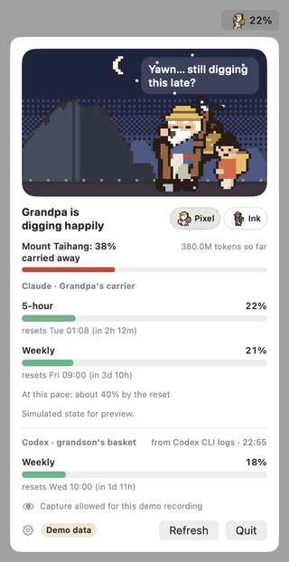
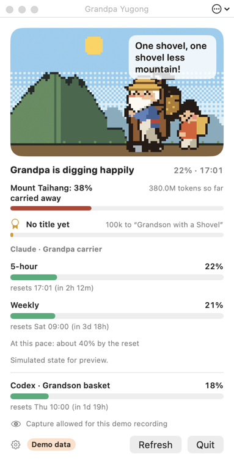

# 우공 펫: 우공 할아버지가 Claude 토큰을 퍼 나릅니다

[English](README.md)



아흔 살에 한 삽씩 산을 옮기기 시작한 옛이야기 속 우공 할아버지가 Mac 메뉴바에 살면서
Claude Code 사용량을 보여 줍니다.

- **지게 = 5시간 한도.** 지게에 흙이 쌓입니다. 가득 차면 앉아서 낮잠을 자고, 메뉴바에 다시
  퍼는 시각이 나옵니다.
- **주간 한도만 있는 계정**(인증된 Ultra): 지게는 주간 한도이고, 그걸 다 써야만 쉽니다.
  오늘 몫(주간의 1/7, 덜 쓴 날은 이월)은 속도만 정해서, 넘으면 땀을 흘리며 천천히 하자고
  합니다. 없는 5시간 미터를 지어내지 않습니다.
- **삽질 속도**(RunCat식): 이 Mac에서 토큰이 빨리 나오면 빨리 파고, 조용하면 삽에 기대
  까치와 수다를 떨고, 리셋 전에 한도에 닿을 속도면 힘에 부쳐 합니다.
- **산**은 지금까지 쓴 모든 토큰만큼 깎입니다(이 Mac에만 저장). 산 하나를 다 옮기면 하늘이
  감동해 과아씨의 두 아들이 산을 업어 가는 짧은 장면이 나오고 다음 산이 나타납니다.
- **이야기 속 사람들.** 요금제를 바꾸거나 새 주가 시작되면 할머니가 와서 "그 흙은 다 어디다
  버리려고?" 하고 묻고(산이 절반 넘게 줄면 응원합니다), 한도를 다 쓰면 지수 영감이 와서 비웃고
  할아버지가 열자의 대답으로 받아칩니다.
- **식구.** 할아버지가 맡을 AI를 고릅니다(기본 Claude). 아들, 손주, 이웃집 아이도 다른 AI를
  하나씩 맡을 수 있습니다: Codex, Gemini CLI, OpenAI·DeepSeek API(한도 대신 월 예산). 기본으로
  손주가 Codex를 맡습니다. Gemini CLI는 Mac에 한도를 남기지 않고 DeepSeek은 잔액만 알려 줘서,
  이 둘은 언제나 모른다고 합니다.
- **칭호.** 옮긴 토큰만큼 칭호가 오릅니다. *삽 든 손주*(첫 한 시간)부터 *산을 옮긴 우공*(몇 달)까지,
  그리고 업적 몇 가지(7일 연속, 주간 한도 지키기, 하루에 AI 둘...). 까치가 픽셀 꽃가루와 함께
  소식을 물어 오고, 칭호 창에서 모두 보고 칭호 카드를 PNG로 저장할 수 있습니다(개인 정보 없음).
- **모르면 모른다고 합니다.** Claude Code가 한도를 알려 주기 전에는 추측하지 않습니다.

메뉴바 캐릭터부터 팝오버 장면, 앱 아이콘까지 모두 픽셀 아트입니다.

## 설치

macOS 13 이상이 필요합니다.

### 앱 내려받기

1. 최신 [GitHub Release](https://github.com/s3onghyun/token-yugong/releases)에서
   `YugongPet-<version>-macos-universal.zip`과 `.sha256` 파일을 함께 내려받습니다.
2. 터미널에서 내려받은 파일을 확인합니다(`<version>`은 릴리스 버전으로 바꾸세요).

   ```sh
   shasum -a 256 -c YugongPet-<version>-macos-universal.zip.sha256
   ```

3. ZIP 파일을 더블 클릭해 푼 다음 `YugongPet.app`을 `/Applications`로 옮깁니다.
4. 이 앱은 ad-hoc 서명 상태이며 아직 **공증(notarization)** 되지 않았습니다. 처음 실행할 때
   앱을 Control-클릭하고 **열기**를 누른 뒤 한 번 더 **열기**를 누르세요. macOS가 먼저 막으면
   **시스템 설정 → 개인정보 보호 및 보안**에서 **그래도 열기**를 누르세요. 공증은 이후
   릴리스에 추가할 예정입니다.

### 소스에서 빌드

로컬 빌드에는 Swift(Xcode 또는 Command Line Tools)가 필요합니다.

```sh
./scripts/bundle.sh          # build/YugongPet.app 생성 (ad-hoc 서명, 공증 안 됨)
open build/YugongPet.app     # 먼저 /Applications로 옮겨도 됩니다
```

처음 실행하면 짧은 안내가 나옵니다. 마지막 장의 **스니펫 복사** 버튼으로 Claude Code
상태줄을 연결합니다(아래). 종료는 팝오버에서 합니다.

번들 없이 `swift run -c release TokenPet`으로도 돌릴 수 있습니다(이때는 알림과 로그인 시
열기가 없습니다).

## Claude Code 연결

Claude Code는 상태줄 명령에 공식 한도(`rate_limits.five_hour`, `rate_limits.seven_day`: 사용
%, 리셋 시각)를 넘겨 줍니다. 브리지 스크립트는 그 객체만 `~/.claude/token-pet/limits.json`에
저장합니다. 프롬프트·경로·세션 ID는 남기지 않고 네트워크도 쓰지 않습니다.

안내(또는 설정 › 사용법과 Claude Code 연결)의 **스니펫 복사**를 누르면 브리지를
`~/.claude/token-pet/`에 넣고 아래 내용을 클립보드에 복사합니다. `~/.claude/settings.json`의
맨 바깥 객체에 직접 붙여 넣으세요. 앱은 이 파일을 고치지 않습니다.

```json
"statusLine": {
  "type": "command",
  "command": "sh ~/.claude/token-pet/statusline-bridge.sh"
}
```

이미 상태줄을 쓰고 있다면 그대로 두고 그 스크립트 첫 줄을
`input=$(cat); printf '%s' "$input" | sh ~/.claude/token-pet/statusline-bridge.sh >/dev/null`
로 바꾼 뒤 JSON은 `$input`에서 읽으세요.

브리지는 `jq`가 있으면 쓰고(macOS 15부터 기본 포함), 없으면 `plutil`을 씁니다.
Codex는 설정할 것이 없습니다. Codex 기록(`~/.codex/sessions`)에 한도가 들어 있습니다.
Gemini CLI도 설정할 것이 없습니다(`~/.gemini/tmp`에서 토큰을 읽음).

**API 예산.** OpenAI API는 설정 › 식구에서 누군가에게 OpenAI를 맡기고, 월 예산(USD)을 넣고
**관리자(Admin) 키**를 붙여 넣습니다(OpenAI는 비용을 관리자 키에만 알려 줍니다). 미터는 이번 달
쓴 돈 ÷ 예산이고 15분마다 묻습니다. DeepSeek은 API 키를 넣으면 잔액이 보입니다. DeepSeek은 쓴
돈을 알려 주지 않아서 미터는 "모름"입니다. 키는 로그인 키체인에만 저장됩니다. 앱이 네트워크를
쓰는 건 이 두 경우와 하루 한 번의 새 버전 확인(아래)뿐입니다.

## 우공 창

메뉴바의 할아버지를 누르면 팝오버가 열립니다. 장면, 산, 칭호, 모든 미터가 여기 있습니다.
처음 실행하면 한 번 "우공을 눌러 보세요"라고 알려 줍니다. 팝오버의 **창으로 보기**를 누르면 같은
장면이 따로 창으로 떠서 바탕화면에 계속 둘 수 있습니다.



끌어서 어디든(세로 모니터 같은 다른 화면도) 옮기고, 모서리를 끌어 크기를 바꾸면 비율을 지키며
커지고 작아집니다. 제목 막대의 ⋯ 단추(또는 오른쪽 클릭)로 작게·보통·크게, 보통 창·*항상 위에*·
*바탕화면에 두기*(모든 앱 창 아래, 모든 Space에), 불투명도를 고릅니다. Esc나 닫기 단추로 닫습니다.
크기, 위치, 위·아래 설정, 불투명도는 기억하고, 그 화면이 없어졌으면 주 화면에 다시 나타납니다. 설정 ›
*앱이 열릴 때 우공 창도 열기*(기본 꺼짐)를 켜면 실행할 때, *로그인할 때 열기*와 함께면 로그인할 때
열립니다. 창이 닫혀 있거나 가려져 있으면 장면을 그리지 않습니다(CPU 0).

## 메뉴바가 꽉 찼을 때

macOS는 메뉴바에 자리가 없는 아이콘을 말없이 숨기거나 카메라 노치 뒤에 둡니다. 할아버지는
이것을 알아채고 알림으로 한 번 알린 뒤 작은 떠 있는 창으로 옮겨 옵니다(끌어서 옮기고, 오른쪽
클릭으로 숨김). 설정 › 작은 창: *메뉴바가 꽉 찼을 때*(기본), *항상*, *끔*. 앱을 다시 열면
언제든 나타납니다. 팝오버로, 또는 메뉴바에 자리가 없고 작은 창도 꺼져 있으면 우공 창으로요.

## 설정

팝오버의 톱니바퀴: 언어(시스템, English, 한국어, 日本語, 简体中文. 재시작 없이 바로 바뀜), 메뉴바 숫자(사용한 %, 리셋까지 남은 시간,
리셋 시각, 없음)와 그 옆 할아버지 보이기, 식구(누가 어떤 AI를 맡나, OpenAI 예산, API 키), 작은 창, 로그인할 때
열기(기본 꺼짐, 직접 켤 때만), 앱이 열릴 때 우공 창도 열기, 새 버전 확인, 사용법 안내. 모두 UserDefaults 도메인 `TokenPet`에 저장되고
`defaults delete TokenPet`으로 산 진행까지 초기화됩니다.

일본어·중국어 문구는 AI의 도움을 받은 번역이라 고쳐 주시면 반갑습니다(문구마다 `L.t(en, ko, ja, zh)`
호출 하나이고, 번역이 빠지거나 다른 문자로 쓰이면 `./test.sh`가 실패합니다).

## 새 버전 알림

앱은 하루 한 번 GitHub에 최신 릴리스를 묻습니다. `api.github.com/repos/s3onghyun/token-yugong/releases/latest`
에 HTTPS GET 하나를 보내고, 머리글은 `User-Agent: YugongPet/<버전>`, `Accept`, 고정값 `Accept-Language: en`
뿐이며 쿠키·캐시를 쓰지 않습니다. 사용자나 사용량에 관한 정보는 보내지 않고 텔레메트리도 없습니다.
새 버전이 나오면 팝오버에 **릴리스 페이지**와 **이 버전 건너뛰기**가 있는 줄이 보이고, 그 버전마다
알림이 한 번 옵니다. 앱이 스스로 내려받거나 설치하지는 않습니다. 새 ZIP을 받아 `.sha256`을 확인하고
[설치](#설치)처럼 앱을 바꿔 주세요. 설정 › *새 버전 확인 (하루 한 번)*으로 끄고, *지금 확인*으로 바로 묻습니다.

## 숫자가 할아버지가 되는 방법

모든 규칙은 [LOGIC.md](LOGIC.md) 한 장에 있고 규칙마다 단위 테스트가 있습니다(`./test.sh`).
요약하면 공식 한도만 쓰고, 리셋 시각이 지나면 새 구간으로 보고, 주간 전용 계정의 하루 몫은
저장 상태 없이 계산하므로 재시작이나 여러 Mac에서도 같은 답이 나옵니다.

## 개발용

`swift run -c release TokenPet`의 플래그와 `TOKENPET_PREFS`는 [README.md](README.md#for-development)에 있습니다.
캐릭터 시트: `swift run -c release YugongSheet <폴더> [--scenes] [--family] [--visitors]`.

## 라이선스

- 앱 코드(`Sources/`, `bridge/`, `scripts/`, `Tests/`): MIT, [LICENSE](LICENSE).
- 우공 할아버지와 `assets/` 아래 전부(`docs/demo.gif` 포함): 모든 권리 보유, 개인 사용 허락.
  [assets/LICENSE.md](assets/LICENSE.md), [assets/PROVENANCE.md](assets/PROVENANCE.md) 참고.

[변경 기록](CHANGELOG.md)
