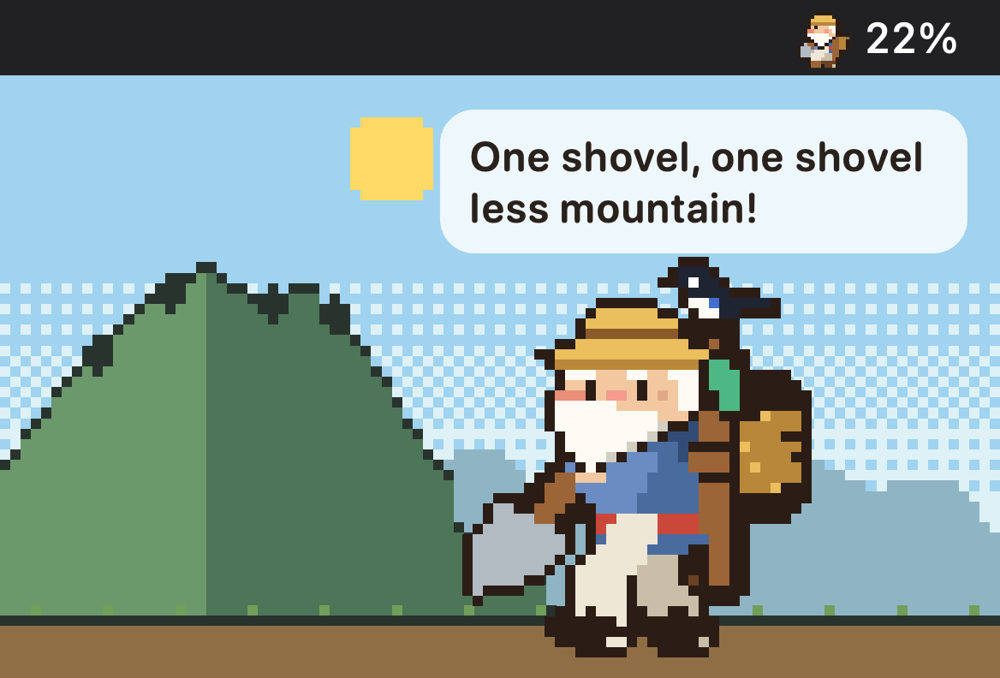
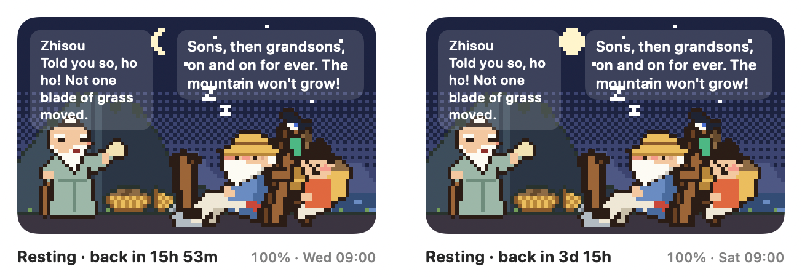
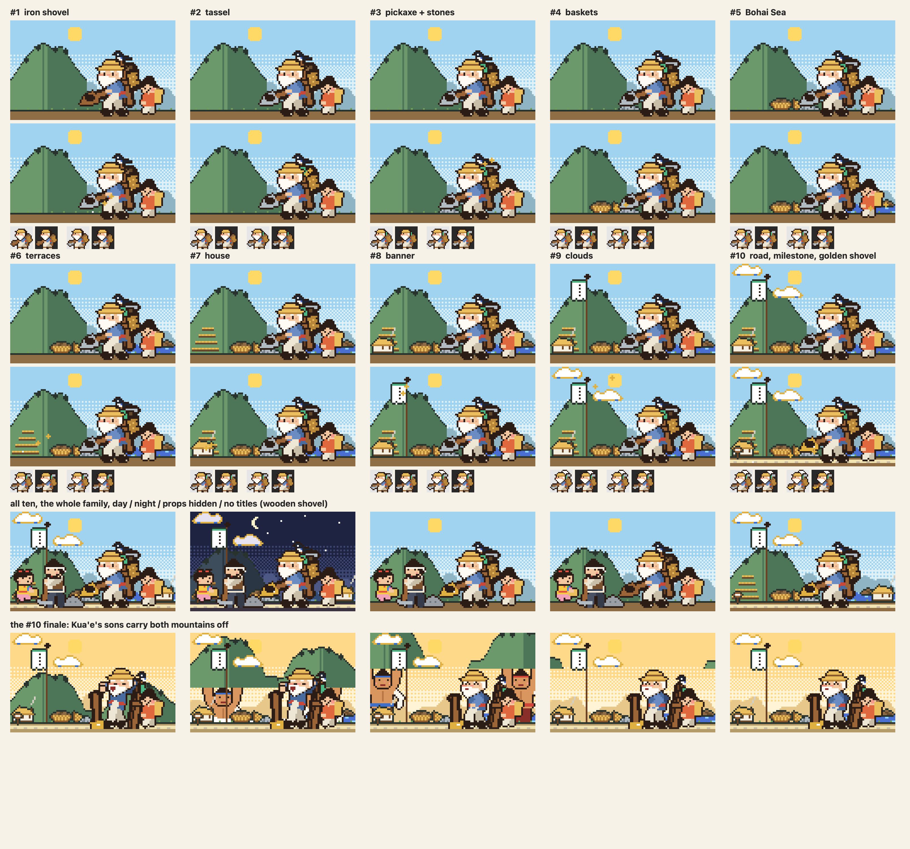
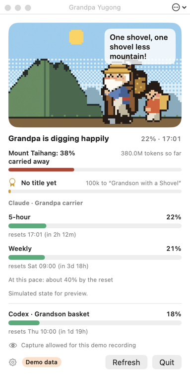

<h1 align="center">Token Yugong 愚公</h1>

<p align="center"><b>Grandpa Yugong moves a mountain one token at a time.</b><br>
A pixel-art menu-bar pet for your Claude Code and Codex usage limits:
his carrier fills with your 5-hour limit, he naps when it runs out, and the mountain wears down with every token.</p>

<p align="center">
  English · <a href="README.zh-CN.md">简体中文</a> · <a href="README.ja.md">日本語</a> · <a href="README.ko.md">한국어</a>
</p>

<p align="center">
  <a href="https://github.com/s3onghyun/token-yugong/releases/latest"></a>
  
  <a href="LICENSE"></a>
  
</p>

<p align="center"><br>
<sub>Drawn by the app's own code with demo data (<code>YugongSheet --hero</code>).</sub></p>

**Install** (macOS 13+, Apple silicon or Intel): download `TokenYugong-<version>-macos-universal.zip` from
[Releases](https://github.com/s3onghyun/token-yugong/releases/latest), unzip, move `TokenYugong.app` to Applications.
Or with Homebrew: `brew install --cask s3onghyun/tap/token-yugong`.
It is not notarized yet, so the first launch needs one approval: see [First launch](#first-launch).
Then [connect Claude Code](#connect-claude-code) (one snippet; Codex needs nothing).

## What it shows

Grandpa Yugong (우공 할아버지), from the old tale of the ninety-year-old man who moved the
mountains one shovel at a time, lives in your Mac menu bar and shows your Claude Code usage:

- **The carrier (지게) is your 5-hour limit.** Earth heaps up in his A-frame carrier. When it is
  full he sits down and naps, the menu bar counts down to the reset, and one notification says so
  (another when it resets). A used-up weekly limit is a long rest under a full moon.

  

- **Accounts with only a weekly limit** (verified Ultra): the carrier is the weekly limit, and he naps
  only when it runs out. Today's fair share (1/7 of the week, unused days carry over) sets his pace:
  past it he sweats and asks you to take it slow. No 5-hour meter is ever invented.
- **His pace** (RunCat-style): he digs faster when tokens flow faster on this Mac, leans on his
  shovel and chats with his magpie when it is quiet, and strains when you are heading for the limit.
- **The mountain** wears down with every token you have ever used (kept on this Mac). Carry a
  whole mountain away and heaven is moved: Kua'e's two giant sons carry it off, then the next
  mountain.
- **The rest of the tale.** His wife drops by when you change plans and at a new week to ask
  where all that earth will go (and cheers once half the mountain is gone); Zhisou comes to laugh
  when the limit runs out, and Grandpa answers him as in the Liezi.
- **The family.** You pick which AI Grandpa watches (Claude by default). His son, his grandson
  and the neighbour's boy can each watch another one: Codex, Gemini CLI, or the OpenAI or
  DeepSeek API (a monthly budget instead of a limit). The grandson watches Codex by default.
- **No data, no guessing.** Until an AI reports its limits, whoever watches it says he doesn't
  know. Gemini CLI keeps no limits on the Mac and DeepSeek reports only a balance, so for those
  he always says so.
- **Titles.** Every token you carry earns a rank, from *Grandson with a Shovel* (the first hour)
  to *Yugong Who Moved the Mountains* (months), plus a few achievements (a 7-day streak, a week
  kept under the limit, two AIs in one day...). The magpie brings the news with pixel confetti;
  the titles window lists them all and saves a shareable title card (PNG, no personal data).
- **Title rewards.** Each title adds one thing to the picture, and it stays: the wooden shovel gets its
  iron blade, then a tassel, a pickaxe, baskets, the Bohai Sea, terraced fields, the family house, the
  family banner, auspicious clouds, and at the top a golden shovel, an open road and a one-time finale
  in which Kua'e's sons carry both mountains off. Five of them show in the menu bar too. Settings ›
  *Hide background props* keeps only Grandpa's gear.

  

All of it is pixel art: the menu-bar sprite, the popover scene and the app icon.

### Menu-bar power use

Yugong renders each distinct 20-point pose once, then uses a one-shot timer (with tolerance) only
until the next distinct pose. It does no menu-bar drawing while the item is hidden or occluded, the
display sleeps, or the session is locked/inactive. Low Power Mode holds the current pose; a countdown
then refreshes once a minute and a percentage-only label at most once every five minutes.

On the development M5 Pro / macOS 26.6.2 machine, a forced high-tempo visible animation measured
2.2–2.6% CPU and about 3,900–4,200 context switches per 10-second `top` sample before this change.
The new Low Power Mode path recorded **3 wakes / 1 redraw in 30 seconds** and 0.0% instantaneous CPU
after settling. This Mac had its built-in display plus two LG 4K displays attached. AppKit replicates
one `NSStatusItem` image to every menu bar and offers no per-display image or active-copy API, so all
copies share the same cached static pose rather than independently animating.

## Install

Needs macOS 13 or later.

### Linux/Windows (beta)

**Experimental.** A separate Tauri 2 desktop shell for Linux and Windows lives in
[`desktop/`](desktop/). It reads local Claude Code and Codex JSONL data, shows an animated tray
pet and a small usage window, and keeps its settings in the platform app-config directory.

Linux builds target AppImage and `.deb`; Windows builds target unsigned MSI and NSIS installers.
They are CI artifacts only for now: there is no release, auto-update, winget, or Flathub package.
On Linux, open the window from the tray menu (some StatusNotifierItem implementations do not send
tray-click events). On Windows, SmartScreen may warn until the project can obtain OSS signing.

Build the beta on a Linux or Windows machine with Rust and Node.js installed:

```sh
npm ci --prefix desktop
npm run tauri --prefix desktop -- build
```

### Homebrew

```sh
brew install --cask s3onghyun/tap/token-yugong
```

`brew upgrade --cask token-yugong` updates it. The first launch still needs one approval ([First launch](#first-launch)).

Homebrew 7 and later load casks from other taps only once you trust them. Installing by the full
name, as above, trusts this one cask by itself. To look at it first with
`brew info --cask s3onghyun/tap/token-yugong`, run `brew trust --cask s3onghyun/tap/token-yugong` before it.

### Download the app

1. Download `TokenYugong-<version>-macos-universal.zip` and its `.sha256` file from the latest
   [GitHub Release](https://github.com/s3onghyun/token-yugong/releases/latest).
2. In Terminal, verify the download (replace `<version>` with the release version):

   ```sh
   shasum -a 256 -c TokenYugong-<version>-macos-universal.zip.sha256
   ```

3. Double-click the ZIP, then move `TokenYugong.app` to `/Applications`.

Coming from Yugong Pet 0.2.0? Quit it and delete `YugongPet.app`; your settings, mountain and titles
carry over (same settings domain). If *Open at login* was on, turn it off and on once in Settings.

### First launch

The app is ad-hoc signed but not notarized yet, so macOS asks once:

1. Open the app. macOS says it cannot verify it; click **Done**.
2. Open **System Settings → Privacy & Security**, scroll down, click **Open Anyway** next to
   Token Yugong, and confirm with Touch ID or your password.
3. On macOS 13-14 you can instead Control-click the app and choose **Open**.

Prefer to check the code first? Build it yourself (below).

### Build from source

For a local build, install the Swift toolchain (Xcode or the Command Line Tools), then:

```sh
git clone https://github.com/s3onghyun/token-yugong.git && cd token-yugong
./scripts/bundle.sh            # builds build/TokenYugong.app (ad-hoc signed, not notarized)
open build/TokenYugong.app     # or move it to /Applications first
```

The first launch shows a short guide (three pages, about 30 seconds, **Skip** any time): what Grandpa
shows, **Connect** for the Claude Code status line (below), and where Settings are. Settings ›
*How it works and Claude Code setup…* opens it again. Quit from the popover.

Or run without a bundle: `swift run -c release TokenPet` (no notifications or open-at-login there).

## Connect Claude Code

Claude Code hands its status-line command your official limits (`rate_limits.five_hour` and
`rate_limits.seven_day`: used %, reset time). The bridge script saves only that object (and a hash of the account) to
`~/.claude/token-pet/limits.json`; no prompts, paths or session ids, no network.
The status line only reports successful responses, so it stops at 99% when a limit runs out; the
app also reads the refusal Claude Code writes to its own session log (`usage_limit_reached`, with
the window and reset time) to show 100% and let Grandpa rest.

**One click:** press **Connect** in the guide (or Settings › How it works). The app shows the
`statusLine` before and after, and only writes when you say so. **One command** (also for agents):

```sh
/Applications/TokenYugong.app/Contents/MacOS/TokenPet setup            # add --dry-run to only look
/Applications/TokenYugong.app/Contents/MacOS/TokenPet setup --undo     # put it back
```

Either way it copies the bridge into `~/.claude/token-pet/` and changes only the `statusLine` key of
`~/.claude/settings.json`: every other byte stays, a backup goes to
`~/.claude/token-pet/settings.json.<time>.bak`, running it again changes nothing, and a symlinked
file stays a symlink. A status line you already have is kept: it becomes
`sh ~/.claude/token-pet/statusline-bridge.sh --chain '<your command>'`, so it gets the same input and
what it prints is still what you see; `--undo` gives your command back. No Claude Code on this Mac
(no `~/.claude`)? It says so and writes nothing.

Prefer to do it by hand? **Copy snippet** copies the bridge and this onto the clipboard, for the
top-level object of `~/.claude/settings.json`:

```json
"statusLine": {
  "type": "command",
  "command": "sh ~/.claude/token-pet/statusline-bridge.sh"
}
```

(by hand, with a status line already there: `"command": "sh ~/.claude/token-pet/statusline-bridge.sh --chain '<your command>'"`).

**Command line.** `TokenPet status [--json]` says whether Claude Code is connected and prints the last
limits it reported; `TokenPet setup [--undo] [--dry-run] [--json]` is the setup above. With `--json`
the output is one JSON object with stable keys (`result`, `before`, `after`, `backup`; `claude.connection`,
`claude.reading.five_hour.used_percentage`, ...); errors go to stderr in plain words, exit 1, and as
`{"error": "no_claude" | "unreadable_settings" | "unknown_status_line" | "no_bridge" | "write_failed"}`.

The bridge uses `jq` when present (built into macOS 15+) and `plutil` otherwise.
Codex needs no setup: its own logs (`~/.codex/sessions`) carry its limits. Gemini CLI needs none
either (its tokens are read from `~/.gemini/tmp`).

**API budgets.** For the OpenAI API, give a member OpenAI in Settings › Family, type a monthly
budget in USD and paste an **Admin key** (OpenAI reports costs only to Admin keys). The meter is
this month's spend ÷ the budget, asked every 15 minutes. For DeepSeek, paste an API key to see the
balance; DeepSeek does not report spend, so its meter says "don't know". Keys go into the login
Keychain only. These two and the update check and download (below) are the only times the app
uses the network.

## The Yugong window

Click Grandpa in the menu bar for the popover: the scene, the mountain and every meter. The ⌄ button
next to Refresh shows the rest (his title, where the numbers come from, the Claude account, the
shovel speed, screen sharing) and is remembered.
The first launch points at him once ("Click Grandpa to see his mountain"). The popover's **Window**
button opens the same scene in a window of its own that stays on the desktop:



Drag it anywhere (another display too, a vertical one included) and drag its corner to resize: the
content scales and keeps its proportions. The ⋯ button in its title bar (or a right-click) picks
small, medium or large, *compact* (the scene and its headline only), a normal window, *always on top* or *on the desktop* (under every app
window, on every Space), and the opacity. Esc or the close button hides it. Size, place, level
and opacity are remembered; if its display is gone, it comes back on the main screen. Settings ›
*Open the Yugong window when the app starts* (off by default) opens it at launch, and with *Open at
login*, at login. While the window is closed or covered the scene stops drawing (no CPU).

## When the menu bar is full

macOS quietly hides menu-bar icons that do not fit, or puts them behind the camera notch.
Grandpa notices, tells you once with a notification, and moves into a small floating window
(Grandpa at twice the bar size with the number; click for the popover on that display, drag it anywhere,
right-click for the Yugong window or to hide it). Settings › Mini window: *when the menu bar is full*
(default), *always* or *never*. Opening the app again always brings him up: the popover, or the
Yugong window when the bar has no room and the mini window is off.

## Settings

Gear button in the popover: language (System, English, 한국어, 日本語, 简体中文; it changes at once, no
restart), the menu-bar number (percent used,
time to reset, reset time or none) and whether Grandpa is shown next to it, the family (which AI
each member watches, the OpenAI budget, API keys), mini window, open at login (off by default, opt-in only), the Yugong window at start, update checks, and the guide. Everything is stored in the
UserDefaults domain `TokenPet`; `defaults delete TokenPet` resets it, including the mountain.

The Japanese and Chinese texts are AI-assisted translations; corrections are welcome (each string is
one `L.t(en, ko, ja, zh)` call, and `./test.sh` fails on a missing or wrong-script translation).

## Updates

Once a day the app asks GitHub for the latest release: one HTTPS GET to
`api.github.com/repos/s3onghyun/token-yugong/releases/latest`, with only `User-Agent: TokenYugong/<version>`,
`Accept` and a fixed `Accept-Language: en`, no cookies and no cache. Nothing about you or your usage is
sent, and there is no telemetry. When a newer version is out, the popover shows a row with **Update**,
**Release page** and **Skip this version**, and you get one notification for that version. Nothing is
downloaded until you click **Update**: then the app fetches that release's ZIP from
`github.com/s3onghyun/token-yugong/releases/download/v<version>/`, unzips it to a temporary folder,
checks it is Token Yugong (same bundle id) at exactly that version with a valid signature
(`codesign --verify`), swaps it in for the app where it runs and restarts. If anything fails, the
current app stays as it was. Installed with Homebrew, the row shows
`brew upgrade --cask s3onghyun/tap/token-yugong` with a Copy button instead, so Homebrew's record stays
right; where the app cannot be replaced (a folder you cannot write to), use the release page and
replace it as in [Install](#install). Settings › *Check for updates (once a day)* turns it off; *Check now* asks
at once.

## Privacy

Token Yugong reads files on your Mac and keeps everything there. No account, no analytics, no telemetry.

| What it reads | Why |
|---|---|
| `~/.claude/token-pet/limits.json` | Claude Code's official limits, written by the status-line bridge (used %, reset time; no prompts, paths or session ids). To tell Claude accounts apart, the bridge reads `oauthAccount.accountUuid` from `~/.claude.json` and writes only a 12-character SHA-256 hash of it |
| Claude Code session logs (`~/.claude/projects`) | token counts for Grandpa's pace and the mountain, and the `usage_limit_reached` refusal so a full limit shows 100% |
| `~/.codex/sessions` | Codex's own limits and token counts |
| `~/.gemini/tmp` | Gemini CLI token counts |

- **Network:** only the once-a-day update check (one GET to the GitHub releases API, can be turned
  off), the release ZIP when you click **Update**, and, only if you paste a key, OpenAI's costs API or DeepSeek's balance API every 15 minutes.
- **Keys** live in your login Keychain, nowhere else.
- **Settings and history** (the mountain, titles) stay in the `TokenPet` UserDefaults domain on this
  Mac; `defaults delete TokenPet` erases them. What the app read from the bridge (hashed account,
  percentages, reset times) is logged to `~/Library/Application Support/TokenPet/claude-readings.log`
  (at most two files of 512 KB), so a wrong account can be traced; delete it any time.
- The app edits `~/.claude/settings.json` only when you press **Connect** (after showing the change) or run
  `TokenPet setup`, and then only its `statusLine`, with a backup; `TokenPet setup --undo` reverses it.

## How the numbers become a pet

Every rule is in one page, [LOGIC.md](LOGIC.md), and every rule has a unit test (`./test.sh`).
In short: official limits only, the reset time decides when a window starts over, and the
weekly-only share needs no saved state, so restarts and several Macs give the same answer.

## For development

`swift run -c release TokenPet` with flags: `--demo lively|steady|straining|resting|morning|cutscene|cycle`,
`--lifetime <tokens>`, `--award rank:<0-9>|feat:<name>`, `--titles` (open the titles window), `--window` (open the Yugong window),
`--tempo idle|low|high|veryHigh`, `--visitor wifeDoubting|wifeCheering|zhisou`, `--weekly-only`, `--lang en|ko|ja|zh|pseudo`
(`pseudo`: every string about 40% longer and accented, to find truncation with `--render`),
`--stage` (bar item and popover in one window, for recording), `--allow-capture`, `--open`,
`--settings`, `--guide`, `--pretend-hidden` (try the mini-window fallback),
`--render <dir>` (PNG stills), `--icon-set <dir>`, `--scan-report` (prints what it read),
`--anim-stats`; `status` and `setup` (Command line, above). `HOME=<dir>` runs it all against a throwaway home. `TOKENPET_PREFS=<domain>` keeps a test run out of your settings.

Character sheets: `swift run -c release YugongSheet <dir> [--scenes] [--family] [--visitors] [--rewards]`.
`--social` draws `docs/social-preview.png`; `--hero` draws the frames of `docs/hero.gif`, then:
`ffmpeg -framerate 10 -i <dir>/hero-%03d.png -vf "split[a][b];[a]palettegen=max_colors=128:stats_mode=full[p];[b][p]paletteuse=dither=none" -loop 0 docs/hero.gif`.

Contributions: see [CONTRIBUTING.md](CONTRIBUTING.md).

## License

- App code (`Package.swift`, `Sources/`, `bridge/`, `scripts/`, `Tests/`): MIT, see [LICENSE](LICENSE).
- Grandpa Yugong and everything under `assets/` (and images made from it, such as the pictures in
  `docs/`) are **not** covered by the MIT license: all rights reserved, with a personal-use grant, see
  [assets/LICENSE.md](assets/LICENSE.md) and [assets/PROVENANCE.md](assets/PROVENANCE.md).

[Changelog](CHANGELOG.md)
