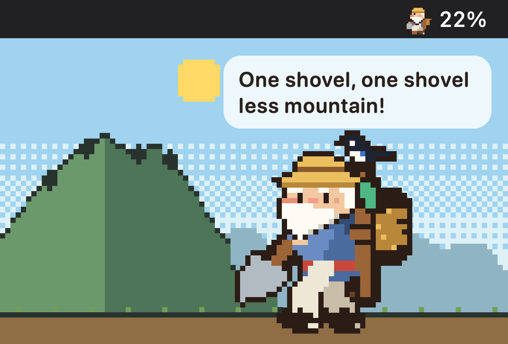
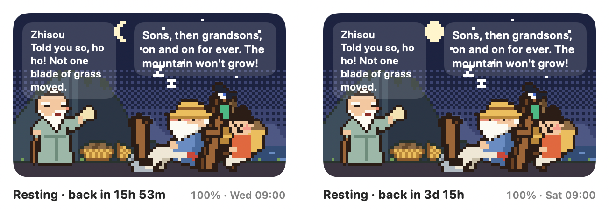
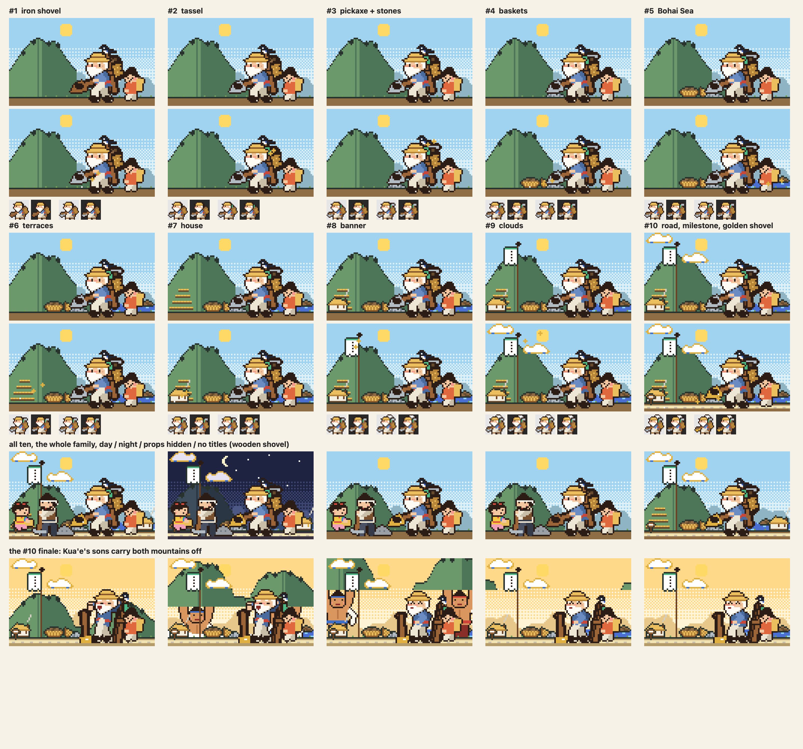
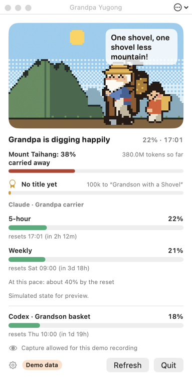

<h1 align="center">Token Yugong 愚公</h1>

<p align="center"><b>愚公爷爷一个 token 一个 token 地移山。</b><br>
一只像素风菜单栏宠物，帮你看着 Claude Code 和 Codex 的用量额度：背架随 5 小时额度慢慢装满，额度用完他就打盹，每用掉一个 token，山就矮一点。</p>

<p align="center">
  <a href="README.md">English</a> · 简体中文 · <a href="README.ja.md">日本語</a> · <a href="README.ko.md">한국어</a>
</p>

> 本文为 AI 辅助翻译，欢迎指正（提 Issue 或 PR）。

<p align="center">
  <a href="https://github.com/s3onghyun/token-yugong/releases/latest"></a>
  
  <a href="LICENSE"></a>
  
</p>

<p align="center"><br>
<sub>由应用自身的代码用演示数据绘制（<code>YugongSheet --hero</code>）。</sub></p>

**安装**（macOS 13+，Apple 芯片或 Intel）：从 [Releases](https://github.com/s3onghyun/token-yugong/releases/latest) 下载 `TokenYugong-<version>-macos-universal.zip`，解压后把 `TokenYugong.app` 移到“应用程序”文件夹。
应用还没有经过公证，首次启动需要手动允许一次：见[首次启动](#首次启动)。
然后[连接 Claude Code](#连接-claude-code)（一段配置即可；Codex 无需设置）。

## 能看到什么

愚公爷爷出自《列子·汤问》里那个年近九十、一锹一锹搬走大山的老人。他住在你的 Mac 菜单栏里，替你显示 Claude Code 的用量：

- **背架就是你的 5 小时额度。** 土在他的木背架里越堆越高。装满后他就坐下打盹，菜单栏开始倒计时到重置，并发一条通知（重置时再发一条）。每周额度用完时，他会在满月下歇上很久。

  

- **只有每周额度的账号**（已在 Ultra 账号上验证）：背架代表每周额度，只有用完时他才打盹。今天的合理份额（一周的 1/7，没用完的天数会累积下来）决定他的节奏：超过份额他就冒汗，劝你慢一点。绝不会凭空编出一个 5 小时额度表。
- **挖土速度**（RunCat 式）：本机 token 流得越快，他挖得越快；安静时就倚着铁锹和喜鹊聊天；快撞上额度时他会挖得很吃力。
- **大山**随你累计用掉的全部 token（保存在本机）慢慢变矮。搬走一整座山就感动了上天：夸娥氏二子把山背走，接着是下一座山。
- **故事的其余部分。** 你更换套餐时、以及新的一周开始时，他的老伴会过来问这么多土往哪儿放（山搬走一半时还会给他加油）；额度用完时智叟会来嘲笑，爷爷照《列子》里的话回答他。
- **一家人。** 你可以选择爷爷看管哪个 AI（默认 Claude）。儿子、孙子和邻家小孩可以各看管另一个：Codex、Gemini CLI，或 OpenAI / DeepSeek API（用月度预算代替额度）。孙子默认看管 Codex。
- **没有数据就不猜。** 在 AI 报告额度之前，看管它的人会说不知道。Gemini CLI 不在 Mac 上记录额度，DeepSeek 只报告余额，所以对这两个他会一直说不知道。
- **称号。** 你搬运的每个 token 都会累积成等级，从*拿铲的孙子*（第一个小时）到*移山的愚公*（要几个月），另有几个成就（连挖七天、一整周守住额度、一天用两个 AI……）。喜鹊会带着像素彩纸来报喜；称号窗口列出全部称号，还能保存一张可分享的称号卡（PNG，不含个人数据）。
- **称号奖励。** 每个称号都会给画面添一样东西，并且一直留着：木铲换上铁刃，然后是流苏、镐、筐、渤海、梯田、自家的茅屋、家里的旗子、祥云，最高处是金铲、一条畅通的大路，以及只播放一次的终场：夸娥氏二子把两座山都背走。其中五样也会出现在菜单栏里。设置 › *隐藏背景小物件* 只保留爷爷自己的工具。

  

全部都是像素画：菜单栏图标、弹出面板里的场景和应用图标。

## 安装

需要 macOS 13 或更高版本。

### 下载应用

1. 从最新的 [GitHub Release](https://github.com/s3onghyun/token-yugong/releases/latest) 下载 `TokenYugong-<version>-macos-universal.zip` 及对应的 `.sha256` 文件。
2. 在“终端”中校验下载的文件（把 `<version>` 换成发布的版本号）：

   ```sh
   shasum -a 256 -c TokenYugong-<version>-macos-universal.zip.sha256
   ```

3. 双击 ZIP 解压，然后把 `TokenYugong.app` 移到 `/Applications`。

从 Yugong Pet 0.2.0 升级？先退出它并删除 `YugongPet.app`；设置、大山和称号都会保留（设置域相同）。如果之前开启了*登录时打开*，请在设置里把它关掉再打开一次。

### 首次启动

应用只做了 ad-hoc 签名，还没有公证，所以 macOS 会询问一次：

1. 打开应用。macOS 提示无法验证它，点 **完成**（Done）。
2. 打开 **系统设置 → 隐私与安全性**，向下滚动，点 Token Yugong 旁边的 **仍要打开**（Open Anyway），再用 Touch ID 或密码确认。
3. 在 macOS 13–14 上，也可以按住 Control 点按应用，选择 **打开**。

想先看看代码？可以自己构建（见下文）。

### 从源码构建

本地构建需要先安装 Swift 工具链（Xcode 或 Command Line Tools），然后：

```sh
git clone https://github.com/s3onghyun/token-yugong.git && cd token-yugong
./scripts/bundle.sh            # builds build/TokenYugong.app (ad-hoc signed, not notarized)
open build/TokenYugong.app     # or move it to /Applications first
```

首次启动会显示一份简短的使用说明，最后一页有 **复制代码片段** 按钮，用于 Claude Code 状态栏（见下文）。要退出时，在弹出面板里退出。

也可以不打包直接运行：`swift run -c release TokenPet`（这样没有通知，也不能登录时打开）。

## 连接 Claude Code

Claude Code 会把你的官方额度（`rate_limits.five_hour` 和 `rate_limits.seven_day`：已用百分比、重置时间）传给它的状态栏命令。桥接脚本只把这个对象保存到 `~/.claude/token-pet/limits.json`；不含提示词、路径或会话 ID，也不联网。
状态栏只报告成功的响应，所以额度用完时会停在 99%；应用还会读取 Claude Code 写进自己会话日志的拒绝记录（`usage_limit_reached`，带有窗口和重置时间），从而显示 100% 并让爷爷休息。

使用说明里（或 设置 › 使用说明）的 **复制代码片段** 会把桥接脚本复制到 `~/.claude/token-pet/`，并把下面这段放进剪贴板。请自己把它粘贴到 `~/.claude/settings.json` 的最外层对象中；应用从不修改这个文件：

```json
"statusLine": {
  "type": "command",
  "command": "sh ~/.claude/token-pet/statusline-bridge.sh"
}
```

已经有状态栏了？保留它，把它的第一行改成
`input=$(cat); printf '%s' "$input" | sh ~/.claude/token-pet/statusline-bridge.sh >/dev/null`，
然后从 `$input` 读取 JSON。

桥接脚本有 `jq` 时用 `jq`（macOS 15+ 自带），否则用 `plutil`。
Codex 无需设置：它自己的日志（`~/.codex/sessions`）里就带有额度。Gemini CLI 也不需要（从 `~/.gemini/tmp` 读取它的 token）。

**API 预算。** OpenAI API：在 设置 › 家人 中给某个成员选 OpenAI，填入以美元计的月度预算，并粘贴一个 **管理员密钥**（Admin key；OpenAI 只向管理员密钥报告费用）。额度表就是本月花费 ÷ 预算，每 15 分钟查询一次。DeepSeek：粘贴 API 密钥即可看到余额；DeepSeek 不报告花费，所以它的额度表显示“不知道”。密钥只存进登录钥匙串。这两项加上每天一次的更新检查（见下文），是应用仅有的联网场景。

## 愚公窗口

点击菜单栏里的爷爷会打开弹出面板：场景、大山、他的称号和所有额度表。首次启动时会提示一次（“点一下爷爷看看”）。弹出面板里的 **窗口** 按钮会在独立窗口中打开同一个场景，一直留在桌面上：



可以拖到任意位置（包括另一块显示器，竖屏也行），拖动角落可以调整大小：内容会等比缩放。标题栏里的 ⋯ 按钮（或右键）可以选择小、中、大，普通窗口、*始终置顶*或*放在桌面上*（在所有应用窗口之下，出现在每个空间），以及不透明度。按 Esc 或关闭按钮可隐藏。大小、位置、层级和不透明度都会被记住；如果原来的显示器不在了，它会回到主屏幕。设置 › *应用启动时同时打开愚公窗口*（默认关闭）会在启动时打开它；同时开了*登录时打开*的话，登录时也会打开。窗口关闭或被遮住时，场景停止绘制（不占 CPU）。

## 菜单栏满时

macOS 会悄悄隐藏放不下的菜单栏图标，或把它们藏到摄像头刘海后面。爷爷会察觉到，发一次通知告诉你，然后搬进一个浮动小窗口（爷爷是菜单栏里的两倍大，带着数字；单击会在那块显示器上打开弹出面板，可以拖到任意位置，右键可打开愚公窗口或隐藏小窗口）。设置 › 小窗口：*菜单栏满时*（默认）、*始终*或*从不*。再次打开应用总能把他叫出来：打开弹出面板；如果菜单栏没有位置且小窗口已关闭，就打开愚公窗口。

## 设置

弹出面板里的齿轮按钮：语言（跟随系统、English、한국어、日本語、简体中文；即时切换，无需重启）、菜单栏数字（已用百分比、距重置、重置时间或无）以及数字旁是否显示爷爷、家人（每位成员看管哪个 AI、OpenAI 预算、API 密钥）、小窗口、登录时打开（默认关闭，只能手动开启）、启动时打开愚公窗口、更新检查，以及使用说明。所有设置都存放在 UserDefaults 域 `TokenPet` 中；`defaults delete TokenPet` 会全部重置，包括大山。

日文和中文文本是 AI 辅助翻译，欢迎指正（每条字符串是一个 `L.t(en, ko, ja, zh)` 调用，缺少翻译或用错文字时 `./test.sh` 会失败）。

## 更新

应用每天向 GitHub 查询一次最新版本：向 `api.github.com/repos/s3onghyun/token-yugong/releases/latest` 发一个 HTTPS GET，只带 `User-Agent: TokenYugong/<version>`、`Accept` 和固定的 `Accept-Language: en`，不带 cookie，也不使用缓存。不会发送任何关于你或你的用量的信息，也没有遥测。有新版本时，弹出面板会显示一行，带有 **发布页面** 和 **跳过此版本**，同一个版本只通知你一次。应用自己从不下载或安装任何东西：请下载新的 ZIP，校验它的 `.sha256`，再按[安装](#安装)一节替换应用。设置 › *检查更新（每天一次）* 可以关闭此功能；*立即检查* 会马上查询。

## 隐私

Token Yugong 读取你 Mac 上的文件，所有数据都留在本机。无需账号，没有统计分析，没有遥测。

| 读取的内容 | 用途 |
|---|---|
| `~/.claude/token-pet/limits.json` | Claude Code 的官方额度，由状态栏桥接脚本写入（已用百分比、重置时间；不含提示词、路径或会话 ID） |
| Claude Code 会话日志（`~/.claude/projects`） | 用于爷爷挖土速度和大山的 token 数，以及 `usage_limit_reached` 拒绝记录，让用完的额度显示为 100% |
| `~/.codex/sessions` | Codex 自己的额度和 token 数 |
| `~/.gemini/tmp` | Gemini CLI 的 token 数 |

- **网络：** 只有每天一次的更新检查（向 GitHub releases API 发一个 GET，可关闭），以及仅在你粘贴了密钥时，每 15 分钟查询一次 OpenAI 的费用 API 或 DeepSeek 的余额 API。
- **密钥**只存在你的登录钥匙串里，别处没有。
- **设置和历史**（大山、称号）保存在本机的 `TokenPet` UserDefaults 域中；`defaults delete TokenPet` 会清除它们。
- 应用从不修改 `~/.claude/settings.json`；状态栏代码片段由你自己粘贴。

## 数字如何变成宠物

所有规则都写在一页 [LOGIC.md](LOGIC.md) 里，每条规则都有单元测试（`./test.sh`）。简而言之：只用官方额度；何时开始新的窗口由重置时间决定；仅每周额度账号的份额计算不需要保存状态，所以重启或换几台 Mac 得到的结果都一样。

## 开发

`swift run -c release TokenPet` 可用的参数：`--demo lively|steady|straining|resting|morning|cutscene|cycle`、
`--lifetime <tokens>`、`--award rank:<0-9>|feat:<name>`、`--titles`（打开称号窗口）、`--window`（打开愚公窗口）、
`--tempo idle|low|high|veryHigh`、`--visitor wifeDoubting|wifeCheering|zhisou`、`--weekly-only`、`--lang en|ko|ja|zh|pseudo`
（`pseudo`：每条字符串加长约 40% 并带上变音符号，配合 `--render` 查找文字被截断的地方）、
`--stage`（把菜单栏图标和弹出面板放进同一个窗口，便于录屏）、`--allow-capture`、`--open`、
`--settings`、`--guide`、`--pretend-hidden`（试用小窗口回退）、
`--render <dir>`（PNG 静帧）、`--icon-set <dir>`、`--scan-report`（打印读到的内容）、
`--anim-stats`。`TOKENPET_PREFS=<domain>` 可以让测试运行不碰你的设置。

角色设定图：`swift run -c release YugongSheet <dir> [--scenes] [--family] [--visitors] [--rewards]`。
`--social` 绘制 `docs/social-preview.png`；`--hero` 绘制 `docs/hero.gif` 的各帧，然后执行：
`ffmpeg -framerate 10 -i <dir>/hero-%03d.png -vf "split[a][b];[a]palettegen=max_colors=128:stats_mode=full[p];[b][p]paletteuse=dither=none" -loop 0 docs/hero.gif`。

参与贡献：见 [CONTRIBUTING.md](CONTRIBUTING.md)。

## 许可证

- 应用代码（`Package.swift`、`Sources/`、`bridge/`、`scripts/`、`Tests/`）：MIT，见 [LICENSE](LICENSE)。
- 愚公爷爷以及 `assets/` 下的全部内容（以及由其生成的图片，例如 `docs/` 中的图片）**不**适用 MIT 许可证：保留所有权利，仅授予个人使用许可，见 [assets/LICENSE.md](assets/LICENSE.md) 和 [assets/PROVENANCE.md](assets/PROVENANCE.md)。

[更新日志](CHANGELOG.md)
