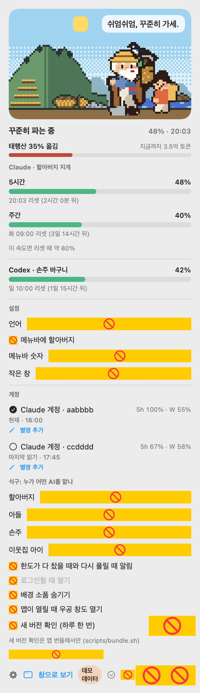

# Usage-reading snapshot contract

## 2026-11-20 reproduction

This is a redacted reconstruction from Token Yugong's local reading log and the bridge's
persisted snapshot. It contains no account identifiers, credentials, request text, or session
identifiers.

| KST | Latest bridge snapshot for one keyed Claude account | What v0.3.4 displayed |
| --- | --- | --- |
| 17:41:25 | 5-hour 100%, weekly 39% | 5-hour 100%, weekly 39% |
| 17:41:55 | 5-hour **not reported**, weekly 54% | 5-hour **100%**, weekly 54% |
| 17:57:38 | 5-hour **not reported**, weekly 55% | 5-hour **100%**, weekly 55% |

The earliest divergence is 17:41:55 KST. At that point the current bridge value was a
weekly-only reading; the current Codex session reader had no recent rate-limit event, so Codex
was unknown rather than evidence for either number.

### Trigger

The same bridge key first receives a two-window snapshot and later receives a newer snapshot
that omits the 5-hour window.

### Masking condition

The old per-window merge retained a still-live 5-hour window whenever a newer snapshot omitted
it. Because the weekly value was replaced independently, the display looked fresh while
combining two different source snapshots.

### Visible symptom

The menu and popover showed an invented `5-hour 100%` beside the latest weekly value and could
put Yugong into a rest state even though the source did not report a 5-hour limit. Missing
windows must instead display as `알 수 없음` (unknown), with the reading age shown separately.

### Headless UI snapshot

The synthetic account-row fixture uses invented keys and values. Before, the selected row mixed
the stale `5h 100%` with `W 55%`; after, it shows only `W 55%` and `현재 · 3분 전 읽음`.

| Before | After |
| --- | --- |
|  |  |

## Contract

For each `AccountKey`, retain only the latest complete `Reading` snapshot (`captured_at` order).
Its windows are displayed exactly as reported. A missing window is unknown; it is never
estimated from an older snapshot or another account.
